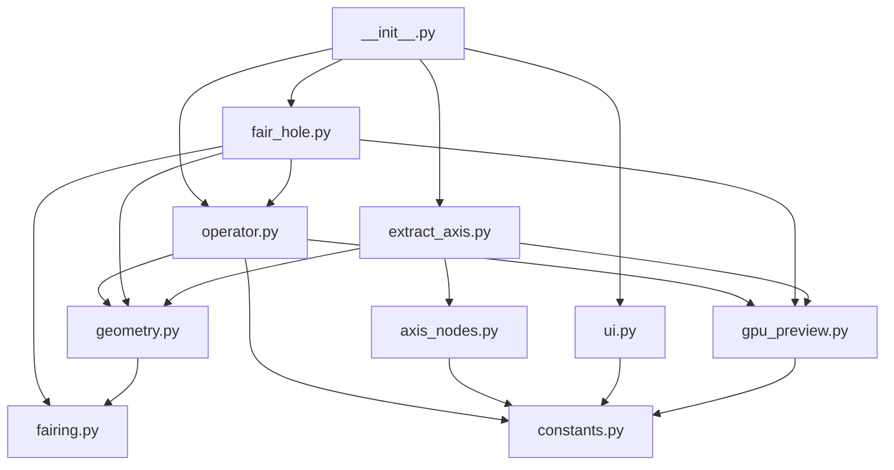

# Architecture

This document describes the high-level structure of Holey Tools and the boundaries between its modules. The extension contains three Blender operators: Resize Hole owns interactive deformation, Fair Hole repairs an open boundary through an ordered fit cascade, and Extract Axis publishes a flooded region to a generated Geometry Nodes modifier backed by reusable fitting assets.

## Package structure

```text
src/
├── __init__.py              Blender extension entry point and legacy metadata
├── axis_nodes.py            Cone-fit wrapper, modifier, and axis indicator
├── assets/                  Bundled Geometry Nodes fitting assets
├── blender_manifest.toml    Extension Platform metadata
├── constants.py             Version, colors, and shared option definitions
├── extract_axis.py          Extract Axis modal operator and face-group storage
├── fair_hole.py             Fair Hole modal selection and operator integration
├── fairing.py               Boundary fitting, patch creation, and organic solve
├── geometry.py              Fitting, flood fill, and mesh deformation
├── gpu_preview.py           Screen-space rendering and drag gizmo
├── operator.py              Modal state machine, input, redo, and cleanup
├── ui.py                    Sidebar panel and registered scene properties
└── docs/                    Developer documentation
```

## Dependency direction



Dependencies should continue to point downward in this diagram. Geometry and GPU code must not import the Blender operator class; this avoids circular imports and keeps those responsibilities independently testable.

## Module responsibilities

### `constants.py`

Contains values shared across modules:

- `ADDON_VERSION`, which drives the viewport and sidebar version display.
- `DIAMETER_ESTIMATOR_ITEMS`, shared by the scene setting and operator property.
- The fallback Face Retopology color used when theme access is unavailable.

It should not import Blender or any other Holey Tools module.

### `geometry.py`

Defines `GeometryMixin`, which is inherited by the operator. It owns operations that read or change mesh geometry:

- Normal-angle flood fill with fitted-surface bridging across missing faces.
- Circular-cone fitting using normal PCA, least-squares axis-plane intersection, line coordinates, and radius-on-height regression.
- Minimum, average, and maximum radius estimation.
- Boundary-plane fitting, planarity validation, and adjacent-face classification.
- Frozen base-surface BVHs and plane/conic/sphere/organic endcap classification.
- Proportional-edit weight calculation.
- Direct deformation for single-plane exterior rims.
- Target-radius BVH probes that promote a nominally planar enlargement to Exact Boolean reconstruction when a tolerance-and-vote test reaches a curved or sloped surrounding cap.
- Transactional base reconstruction and Exact Boolean subtraction for every multi-plane, curved, or organic exterior surface.
- Reversible 16-sided live Boolean previews restored from a pristine mesh snapshot, throttled to 0.5-second intervals during dragging and followed by a trailing release update and source-resolution confirmation.
- Reconstruction-depth fitting from the hole-axis intersections with the accepted exterior surface and blind cap.

Geometry methods operate through attributes on the operator, but do not know about modal events, sidebar layout, or GPU drawing. Its fair-surface dependency is algorithmic only: fitting and temporary patch construction are called with mesh data and callbacks, without importing either Blender operator class.

### `gpu_preview.py`

Defines `GpuPreviewMixin` and small drawing helpers. It owns:

- Triangulating selected faces for the hover tint.
- Building ideal circular-cone/cylinder preview geometry.
- Projecting world coordinates into viewport pixels.
- Drawing fill and outlines in `POST_PIXEL`, independently of depth/X-Ray state.
- Drawing diameter/depth/conic-angle labels and drag gizmos.
- Hit-testing the drag gizmo.

The preview color comes from `ThemeView3D.face_retopology`. The diameter symbol is defined by a Unicode escape so source-file encoding cannot silently change it.

### `operator.py`

Defines `MESH_OT_holey_tools_resize_hole`, the modal Blender operator. It combines `GeometryMixin` and `GpuPreviewMixin` with `bpy.types.Operator` and owns:

- Operator dimension properties and transient modal state.
- Viewport ray casting and hover updates.
- Mouse, keyboard, numeric, snapping, and navigation events.
- Original-selection, original-coordinate, and Boolean-preview source restoration.
- Serialization of fitted data into hidden redo properties.
- Reversible low-resolution Boolean reconstruction during modal adjustment and source-resolution reconstruction on confirmation.
- Creation and cleanup of draw handlers.

`_PersistentPreview` is a plain Python object in this module. It retains only drawing data after the Blender operator's RNA wrapper is destroyed, preventing stale-RNA `ReferenceError` failures while the Adjust Last Operation panel remains active.

### `extract_axis.py`

Defines `MESH_OT_holey_tools_extract_axis`. It uses the same normal-angle flood, screen-space tint, bracket/direct-entry controls, ray casting, viewport-navigation pass-through, and cancellation semantics as Resize Hole. Confirmation writes a zero/one integer attribute on the face domain and selects the same faces in Edit Mode. Integer storage is used because BMesh can update it directly; the generated Named Attribute node reads it as a boolean selection.

### `fair_hole.py`

Defines `MESH_OT_holey_tools_fair_hole`. Screen-space edge picking seeds a pure connectivity flood across edges with one linked face. The resulting component is accepted only when every boundary vertex has degree two and the walk returns one simple closed loop. It shares the draw-handler registry, modal-session guard, and line-overlay renderer with the other interactive tools, but it does not use a face-angle threshold. Confirmation delegates all fitting and topology changes to `fairing.py`. Its redo panel can independently override the selected surface hypothesis and the grid/circular patch topology. Resize Hole's Boolean base reconstruction enters the same preparation, patch-construction, and finalization API instead of maintaining a second fairing implementation.

### `fairing.py`

Owns the ordered repair cascade and is independently headless-testable:

1. Consecutive rim supports are grown into one to three least-squares planes. A one-plane projection, two-plane line point nearest the rim center, or three-plane intersection supplies the cap center. Distinct plane normals separated by less than 0.4° are treated as parallel.
2. The shared circular-cone fit from `GeometryMixin` is accepted when its rank is sufficient and its relative radial residual is at most 3%.
3. A sphere center is fitted by least-squares intersection of the adjacent face normal lines, with both radial and normal residual checks. Cone/cylinder and sphere are always evaluated together, and the lower accepted residual wins.
4. The fallback snapshots every non-loop edge incident to the boundary, then applies a targeted 10° boundary dissolve before creating grid topology. Spoke-connected vertices and all exterior edges are protected; only boundary-only vertices with compatible support normals are removed. A four-way folded SVD of the saved spokes establishes the grid axes without the equal-population 45° ambiguity. Spoke anchor points align grid-line phase to the source topology. The simplified boundary count and aspect ratio set the interval budget; constrained 2D Delaunay clips it. A thin-plate height field samples the rim plus its exterior one-ring to avoid row seams while changing only fitted-axis heights. A graph Laplacian is used only when the thin-plate constraints are degenerate.

The public lifecycle is split into `prepare_fair_boundary`, `fair_boundary_loop`, and `finalize_fair_patch`. Preparation owns rim simplification and pre-simplification direction sampling; construction owns the chosen topology and surface projection; finalization owns seam welding and the optional expanded dissolve. Fair Hole enables the full final simplification. Resize Hole disables only that last optional dissolve while its reconstructed surface is serving as an Exact Boolean operand, retaining enough local topology for a stable cut. It also retains the surface hypothesis classified from the intact support patch rather than rerunning the automatic cascade over a reduced post-delete rim; sphere and cylinder alone refit after their pre-dissolve step. Resize Hole exposes the same surface, Grid/Circle, loop-count, grid-angle, and final-simplification controls in its redo panel.

The automatic choices remain the defaults. Redo can force N-plane, cylinder, sphere, or organic fitting and can independently request a clipped grid or circular rings. Analytic grid vertices are projected back onto the chosen surface; organic circular rings receive the same thin-plate height solve as the grid. A separate default-on redo toggle controls the final one-ring selection growth and limited dissolve without disabling the seam weld. Circle topology accepts a configurable ring count. Grid topology accepts an angular offset applied after its source-edge SVD alignment. Sphere construction uses the same boundary-inclusive Blender pre-dissolve stage as cylinder construction, then refits before generating the patch.

A normal-delimited 0.1° limited dissolve simplifies the boundary before this cascade. Afterward, the patch is merged by distance, its face region expands by one adjacency ring, and the same limited dissolve cleans that expanded region. The operator keeps a mesh snapshot so failure restores the pre-dissolve topology.

A cylindrical repair boundary-dissolves its initial support region, collapses the original rim only along the fitted axis, merges at 0.0001, grows the affected faces once, and limited-dissolves the result. Conic and sphere patches place radial topology onto the accepted surface. Degenerate faces or a singular organic solve abort instead of leaving a partial patch.

### `axis_nodes.py`

Creates and reuses the **Holey Tools Extract Axis** wrapper and appends the bundled **Fit Circular Cone** asset and its dependencies when needed. The wrapper isolates the named face group and samples the fit's axis point, direction, radius, slope, half angle, and rank. This least-squares fit supports circular cones and is more tolerant of missing faces and irregular topology than selecting a PCA outlier. The tool installs the wrapper as an **Extract Axis** modifier. It joins either a generated mesh arrow or an optional object's geometry at the fitted point, aligned from local +Z to the axis. Generated wrappers carry a private version marker so an unrelated user node group with the preferred name is never overwritten.

### `ui.py`

Contains the Holey Tools sidebar panel and the scene-level diameter-estimator setting. It refers to the operator by its stable ID, `mesh.holey_tools_resize_hole`, rather than importing the operator class.

### `__init__.py`

This is the extension entry point Blender loads. It exposes `bl_info` for legacy development installs and directly registers the operator, panel, and scene properties. Its unregister path calls the operator module's runtime cleanup before removing Blender classes.

## State ownership

Operator-instance attributes hold all state specific to an invocation, including the active object, selected face indices, fitted circular cone, original coordinates, preview geometry, numeric input, active dimension, and gizmo rectangles.

`operator.py` has three module-level runtime values shared by the modal tools:

- `_modal_active` records whether a Holey Tools modal session is active.
- `_draw_handles` tracks every installed viewport draw handler for cleanup.
- `_persistent_preview` owns the post-operation cone/cylinder preview.

No runtime state is written to disk or sent over the network.

## Adding another tool

New Holey Tools should normally receive their own operator module. Reuse focused geometry or preview helpers only when their behavior is genuinely shared. Register the new operator in `__init__.py`, expose its UI from `ui.py`, and add headless tests for its core behavior.
