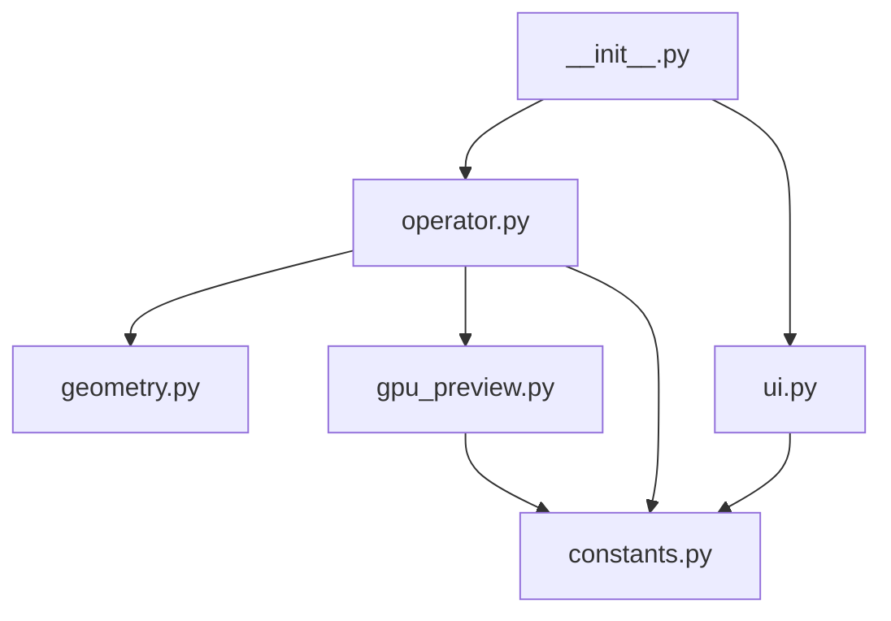

# Architecture

This document describes the high-level structure of Holey Tools and the boundaries
between its modules. The extension currently contains one Blender operator, but the
layout is intended to support additional hole-editing tools without growing another
monolithic module.

## Package structure

```text
src/
├── __init__.py              Blender extension entry point and legacy metadata
├── blender_manifest.toml    Extension Platform metadata
├── constants.py             Version, colors, and shared option definitions
├── geometry.py              Fitting, flood fill, and mesh deformation
├── gpu_preview.py           Screen-space rendering and drag gizmo
├── operator.py              Modal state machine, input, redo, and cleanup
├── ui.py                    Sidebar panel and registered scene properties
└── docs/                    Developer documentation
```

## Dependency direction



Dependencies should continue to point downward in this diagram. Geometry and GPU
code must not import the Blender operator class; this avoids circular imports and
keeps those responsibilities independently testable.

## Module responsibilities

### `constants.py`

Contains values shared across modules:

- `ADDON_VERSION`, which drives the viewport and sidebar version display.
- `DIAMETER_ESTIMATOR_ITEMS`, shared by the scene setting and operator property.
- The fallback Face Retopology color used when theme access is unavailable.

It should not import Blender or any other Holey Tools module.

### `geometry.py`

Defines `GeometryMixin`, which is inherited by the operator. It owns operations that
read or change mesh geometry:

- Normal-angle flood fill.
- SVD cylinder-axis fitting and algebraic circle-center fitting.
- Minimum, average, and maximum radius estimation.
- Boundary-plane fitting for skewed hole ends.
- Proportional-edit weight calculation.
- Absolute radial deformation and end-plane reprojection.

Geometry methods operate through attributes on the operator, but do not know about
modal events, sidebar layout, or GPU drawing.

### `gpu_preview.py`

Defines `GpuPreviewMixin` and small drawing helpers. It owns:

- Triangulating selected faces for the hover tint.
- Building ideal-cylinder preview geometry.
- Projecting world coordinates into viewport pixels.
- Drawing fill and outlines in `POST_PIXEL`, independently of depth/X-Ray state.
- Drawing the diameter label and horizontal drag gizmo.
- Hit-testing the drag gizmo.

The preview color comes from `ThemeView3D.face_retopology`. The diameter symbol is
defined by a Unicode escape so source-file encoding cannot silently change it.

### `operator.py`

Defines `MESH_OT_holey_tools_resize_hole`, the modal Blender operator. It combines
`GeometryMixin` and `GpuPreviewMixin` with `bpy.types.Operator` and owns:

- Operator properties and transient modal state.
- Viewport ray casting and hover updates.
- Mouse, keyboard, numeric, snapping, and navigation events.
- Original-selection and original-coordinate restoration.
- Serialization of fitted data into hidden redo properties.
- Creation and cleanup of draw handlers.

`_PersistentPreview` is a plain Python object in this module. It retains only drawing
data after the Blender operator's RNA wrapper is destroyed, preventing stale-RNA
`ReferenceError` failures while the Adjust Last Operation panel remains active.

### `ui.py`

Contains the Holey Tools sidebar panel and the scene-level diameter-estimator setting.
It refers to the operator by its stable ID, `mesh.holey_tools_resize_hole`, rather than
importing the operator class.

### `__init__.py`

This is the extension entry point Blender loads. It exposes `bl_info` for legacy
development installs and directly registers the operator, panel, and scene properties.
Its unregister path calls the operator module's runtime cleanup before removing Blender
classes.

## State ownership

Operator-instance attributes hold all state specific to an invocation, including the
active object, selected face indices, fitted cylinder, original coordinates, preview
geometry, numeric input, and gizmo rectangle.

`operator.py` has three module-level runtime values:

- `_modal_active` records whether Resize Hole owns an active modal session.
- `_draw_handles` tracks every installed viewport draw handler for cleanup.
- `_persistent_preview` owns the post-operation cylinder preview.

No runtime state is written to disk or sent over the network.

## Adding another tool

New Holey Tools should normally receive their own operator module. Reuse focused
geometry or preview helpers only when their behavior is genuinely shared. Register the
new operator in `__init__.py`, expose its UI from `ui.py`, and add headless tests for
its core behavior.
