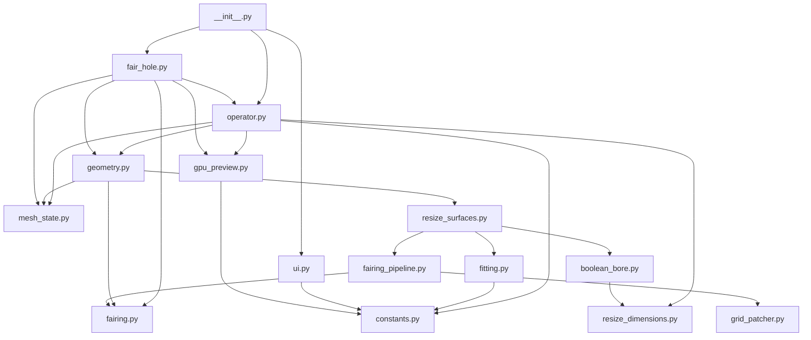

# Architecture

This document describes the high-level structure of Holey Tools and the boundaries between its modules. The extension currently registers two Blender operators: Resize Hole owns interactive deformation, and Fair Hole repairs an open boundary through an ordered fit cascade. The experimental Extract Axis source remains parked in the repository but is not registered or shown in the UI, and its Geometry Nodes `.blend` library is excluded from release bundles until that feature is ready.

## Package structure

```text
src/
├── __init__.py              Blender extension entry point and legacy metadata
├── axis_nodes.py            Parked experimental axis-node implementation
├── assets/                  Development-only Geometry Nodes fitting assets
├── blender_manifest.toml    Extension Platform metadata
├── boolean_bore.py          Topology-preserving cone/bore Boolean junctions
├── boolean_transaction.py   Temporary Boolean resources and identity-safe rollback
├── constants.py             Version, colors, and shared option definitions
├── extract_axis.py          Parked experimental Extract Axis operator
├── face_curvature.py        Refined-face tangent sampling and normal-variation jets
├── fair_hole.py             Fair Hole modal selection and operator integration
├── fairing.py               Boundary fitting, patch creation, and organic solve
├── fairing_pipeline.py      Shared Grid/Circle fill policy and trial isolation
├── fitting.py               Circular-cone fitting, end planes, and wall selection
├── geometry.py              Deformation, reconstruction, and preview lifecycle
├── gpu_preview.py           Screen-space rendering and drag gizmo
├── grid_patcher.py          Staged source-boundary preparation
├── ideal_surface.py         Curvature-aware surface continuation
├── intrinsic_surface.py     Frozen 3D bending reference for folded height charts
├── manhattan.py             Boundary-driven grid layout and relaxation
├── grid_quality.py          Quad distortion scoring and boundary-locked optimization
├── mesh_state.py            Identity-preserving mesh restoration for native undo
├── modal_session.py         Live operator ownership and idempotent cancellation
├── operator.py              Modal state machine, input, redo, and cleanup
├── preview_cache.py         View-dependent projection and bounded GPU batch caches
├── resize_dimensions.py     Blender-independent dimension math and callbacks
├── resize_state.py          Scoped invalidation of mesh-derived Python caches
├── resize_surfaces.py       Support-surface fitting, projection, and mode policy
├── row_patcher.py           Grid mesh construction and surface projection
├── ui.py                    Sidebar panel and registered scene properties
├── visible_geometry.py      Visible-only working meshes and hidden-data preservation
└── docs/                    Developer documentation
```

## Dependency direction



Dependencies should continue to point downward in this diagram. Geometry and GPU code must not import the Blender operator class; this avoids circular imports and keeps those responsibilities independently testable.

## Module responsibilities

### `constants.py`

Contains values shared across modules:

- `ADDON_VERSION`, which drives the viewport and sidebar version display.
- `DIAMETER_ESTIMATOR_ITEMS`, shared by the scene setting and operator property.
- The fallback Face Retopology color used when theme access is unavailable.

It should not import Blender or any other Holey Tools module.

### `geometry.py`

Defines `GeometryMixin`, the stable composed interface inherited by both operators and used by headless callers. It owns proportional deformation, topology fingerprints, transactional reconstruction, final cleanup, and preview/source-mesh lifecycle. Fitting, dimension policy, support classification, and preserved-bore geometry live in the focused modules below; inherited method names remain available through `GeometryMixin`.

Together these modules provide:

- Normal-angle flood fill with fitted-surface bridging across missing faces.
- Circular-cone fitting using normal PCA, least-squares axis-plane intersection, line coordinates, and radius-on-height regression.
- Minimum, average, and maximum radius estimation.
- Boundary-plane fitting, planarity validation, and adjacent-face classification.
- Frozen base-surface BVHs and plane/conic/sphere/organic endcap classification.
- Proportional-edit weight calculation.
- Direct deformation for single-plane exterior rims.
- Target-radius BVH probes that promote a nominally planar enlargement to Exact Boolean reconstruction when a tolerance-and-vote test reaches a curved or sloped surrounding cap.
- Transactional base reconstruction and Exact Boolean subtraction for every multi-plane, curved, or organic exterior surface.
- Local countersink Booleans that preserve compatible cylindrical bore topology, source angular alignment, and axial subdivisions, with a short junction transition for differing resolutions and a guarded general-reconstruction fallback.
- Distinct temporary material tags for fair-surface cleanup, avoiding the material-index collapse caused by empty slots and releasing the tags with their operand meshes.
- Reversible 32-sided live Boolean previews restored from a pristine mesh snapshot, throttled to 0.5-second intervals during dragging and followed by a trailing release update and source-resolution confirmation.
- Reconstruction-depth fitting from the hole-axis intersections with the accepted exterior surface and blind cap.

Geometry methods operate through attributes on the operator, but do not know about modal events, sidebar layout, or GPU drawing. Its fair-surface dependency is algorithmic only: fitting and temporary patch construction are called with mesh data and callbacks, without importing either Blender operator class.

### `boolean_transaction.py`

Owns the synchronized source snapshot, hidden-geometry partition, temporary cutter/display objects, unapplied modifier, and material tags for one reconstruction attempt. Geometry orchestration explicitly calls `rollback()` on failure and `close()` in `finally`; successful live previews transfer object/modifier ownership with `release_preview()`. The source snapshot stays alive until cleanup, including the final Edit Mode transition, and rollback overwrites mesh contents without replacing the real mesh ID. Removing an untransferred display also frees its detached mesh. This module owns resources, not fitting, surface policy, or modal state.

### `resize_state.py`

Centralizes mesh-derived cache invalidation without importing Blender. `invalidate_projection()` discards topology-dependent surface maps while retaining the fit and mode policy; `reset_deformation()` drops original coordinates, proportional weights, and the wall cache after source restoration. `reset_mesh_derived_state()` combines these with fit/hover/policy invalidation for fresh invocation and redo execution. It never clears serialized RNA fits, user choices, or owned native resource references; lifecycle callers must explicitly release Blender resources. Mutable cache containers are fresh for each reset and operator.

### `fitting.py`

Defines `FittingMixin`: gap-aware normal-angle flood fill, the normal-PCA/least-squares circular-cone fit, end-plane recovery, and adjustable-depth classification. All fits use world coordinates. Before axis/radius fitting, a bounded normal-plane refinement rejects clearly separated outliers only when at least 80% of both face count and face area agree. The remaining normal plane may have a nonzero offset, preserving genuine shallow cones instead of imposing a larger cone-angle cutoff. Rejected faces contribute neither axis planes nor vertex/radius samples, but the source geometry and selection remain unchanged; the fit records their count for diagnostics. Major neighboring surfaces and deliberate cylinder/chamfer mixtures are not silently trimmed. It imports neither operator nor reconstruction code and does not modify mesh geometry.

The gap-bridging pass checks a signed normal dot product against the fitted wall normal: inward for holes and outward for studs, including the cone's axial normal component. Opposite-facing faces cannot join the selection merely because their tangent plane and position match. The pass retains its existing 25° model-normal tolerance and radial/axial limits; the connected walk separately uses the user-selected flood angle.

### `resize_dimensions.py`

Defines `ResizeDimensionsMixin` and the conic RNA update callbacks using only Python's `math` module. This keeps radius/angle/depth evaluation and callback coupling testable without Blender. Shared helpers retain the small-circle radius, recover from zero-depth closure, and guard coupled assignments against recursive callbacks. The callbacks are imported by `operator.py`, preserving its existing callback import paths.

### `boolean_bore.py`

Defines `BooleanBoreMixin`, based only on dimension policy. It detects the already-classified cylinder continuation, prepares its local cap, builds a source-phase-aligned cone cutter and optional resolution transition, updates the retained live junction, and restores radius for the general clearance-cut fallback. It consumes fitting/surface state but never imports `geometry.py` or the operator.

### `resize_surfaces.py`

Defines `ResizeSurfaceMixin`, composing fitting and bore/dimension capabilities. It owns frozen support BVHs, planar/spherical/conic/organic classification, axis projections, cone/bore continuation detection, angular-resolution estimation, reconstruction-depth fitting, direct conic exit connections, and Auto-versus-explicit mode policy. `GeometryMixin` inherits this layer; lower layers never import the composed class, keeping dependencies acyclic.

### `gpu_preview.py`

Defines `GpuPreviewMixin` and small drawing helpers. It owns:

- Triangulating selected faces for the hover tint.
- Building ideal circular-cone/cylinder preview geometry.
- Projecting world coordinates into viewport pixels.
- Drawing fill and outlines in `POST_PIXEL`, independently of depth/X-Ray state.
- Drawing diameter/depth/conic-angle labels and drag gizmos.
- Hit-testing the drag gizmo.

The preview color comes from `ThemeView3D.face_retopology`. The diameter symbol is defined by a Unicode escape so source-file encoding cannot silently change it.

### `preview_cache.py`

Owns the latest projected overlay, its fill/outline batches, the two built-in shaders, and one batch per fixed HUD role. The cache belongs to an individual modal or persistent drawing owner and is replaced when its window context changes; there is no global GPU cache. Published world-space geometry lists are treated as immutable and retained by identity. List replacement, a changed perspective matrix, region identity/size, or selection/cylinder stage rebuilds projection and batches. A single per-build point map shares projections between triangles and lines, including clipped points. The cylinder silhouette uses the same projected convex hull as before. Cache misses publish only after successful construction, so transient GPU failures remain retryable. Theme colors, line widths, framebuffer dimensions, labels, and hit rectangles remain live on every draw without invalidating geometry. HUD slots replace their prior batch rather than accumulating a history of mouse positions. Modal/fairing clear paths, handoff to the persistent overlay, and persistent removal explicitly drop the cache; it retains no operator, scene object, or BMesh.

### `operator.py`

Defines `MESH_OT_holey_tools_resize_hole`, the modal Blender operator. It combines `GeometryMixin` and `GpuPreviewMixin` with `bpy.types.Operator` and owns:

- Operator dimension properties and transient modal state.
- Viewport ray casting and hover updates.
- Mouse, keyboard, numeric, snapping, and navigation events.
- Original-selection, original-coordinate, and Boolean-preview source restoration.
- Serialization of fitted data into hidden redo properties.
- Reversible low-resolution Boolean reconstruction during modal adjustment and source-resolution reconstruction on confirmation.
- Creation and cleanup of draw handlers.

`_PersistentPreview` is a plain Python object in this module. It retains only drawing data after the Blender operator's RNA wrapper is destroyed, preventing stale-RNA `ReferenceError` failures while the Adjust Last Operation panel remains active.

### `extract_axis.py`

This parked development module defines `MESH_OT_holey_tools_extract_axis`, but the extension entry point does not import or register it and the sidebar does not expose it. Its source remains available for later refinement.

### `fair_hole.py`

Defines `MESH_OT_holey_tools_fair_hole`. Screen-space edge picking seeds a connectivity flood across one-face edges. A valid component has degree two at every boundary vertex and is one closed loop. The operator shares modal/draw runtime with Resize Hole without an angle threshold. New invocations reset to sidebar preselected Auto/Auto defaults and full fill. `fairing_pipeline.py` supplies the same transactional Manhattan/Circle policy as Resize Hole. The build-time development flag exposes cumulative preparation stages; normal Grid exposes only the default-enabled C2 toggle. One post-mirror pass is fixed. Explicit Grid honors the selected analytic/organic hypothesis and never silently falls back.

### `fairing.py`

Owns the ordered repair cascade and is independently headless-testable:

1. Consecutive rim supports are grown into one to three least-squares planes. A one-plane projection, two-plane line point nearest the rim center, or three-plane intersection supplies the cap center. Distinct plane normals separated by less than 0.4° are treated as parallel.
2. The shared circular-cone fit from `GeometryMixin` is accepted when its rank is sufficient and its relative radial residual is at most 3%.
3. A sphere center is fitted by least-squares intersection of the adjacent face normal lines, with both radial and normal residual checks. Cone/cylinder and sphere are always evaluated together, and the lower accepted residual wins.
4. Spherical and organic Auto fits attempt the complete Manhattan patcher, including boundary repair, one post-mirror pass, relaxation, and ideal-surface projection. An infeasible grid falls back to five circular rings. The folded SVD supplies the grid chart frame; boundary topology determines template counts, not density. Both Fair Hole and Resize Hole use this pipeline; obsolete native and cross-field backends have been removed.

`fairing_pipeline.fair_hole_patch` is the shared policy for Fair Hole and Resize Hole. Auto grid preparation is first probed on a standalone BMesh, so failure cannot modify the source rim. Success replays deterministic preparation on the live mesh, preserving unaffected source element identities. Explicit Grid and developer inspection stages never silently fall back. Non-Grid paths use `prepare_fair_boundary`, `fair_boundary_loop`, and `finalize_fair_patch` for pre-dissolve, construction/projection, and optional expanded cleanup. Resize Hole retains the accepted intact-surface hypothesis and refits only the same analytic model after pre-dissolve. It keeps reconstruction subdivisions until Boolean subtraction. Both operators expose the default-enabled C2 toggle; only development Fair Hole exposes staged inspection.

Auto's successful probe shares one private numeric row plan with live replay, avoiding a second topology search, surface fit, and relaxation solve. Replay verifies the refined rim order, chart frame, object transform, visible local fitting geometry/connectivity, valences, protected points, analytic projection parameters, and smoothing options. Ambiguous coincident source points disable reuse. Only layout arrays, frozen surface evaluators, and numeric depth samples cross that boundary; trial BMesh handles never do. Construction still occurs on the live mesh with its own attributes and source identities. The cache is discarded with the invocation and cannot resurrect a previous repair. Failed probes retain their existing Circle fallback and cleanup behavior.

Both operators default to Auto Fit followed by Auto Topology. The sidebar can preselect Fair Hole defaults independently of redo, and invocation resets full-fill state. The build-time development flag exposes staged grid inspection and relaxation diagnostics; in normal builds, C2 curvature matching is the only grid-specific control. Explicit Grid requires a valid Manhattan template. Circle accepts a configurable ring count (five by default) and projects onto the accepted analytic/organic fit. Non-Grid final simplification remains optional. Sphere Circle and Cylinder refit after boundary-inclusive pre-dissolve. Grid uses source topology independently of the selected fit: analytic fits use exact surface intersections, while Organic uses curvature continuation.

Pre-dissolve can close a planar opening without requiring a patch. Boundary rediscovery is scoped to surviving original rim vertices/edges and local support output, with no global nearest-boundary fallback. If the opening disappears and valid support faces survive, `prepare_fair_boundary` returns a completed PLANES/PLANE result. The shared pipeline skips refitting and construction, retaining those faces for selection, Boolean material tags, and optional final cleanup. Deletion of the support surface or degenerate output is still an error. Native dissolve output selection tracks replacement faces when original BMesh face identities have been invalidated.

A normal-delimited 0.1° limited dissolve simplifies the boundary before this cascade. Afterward, the patch is merged by distance, its face region expands by one adjacency ring, and the same limited dissolve cleans that expanded region. The operator keeps a mesh snapshot so failure restores the pre-dissolve topology.

Non-Grid boundary preparation first calls `weld_collapsed_boundary_edges` to merge connected rim edges at most 1e-8 mesh units long, before angle tests that cannot classify zero-length edges. It tracks the surviving loop with live elements and retains support coordinates instead of averaging positions. Nearby disconnected vertices/other openings are excluded. A triangulated duplicate corner may leave a zero-area ear; only that already-degenerate incident triangle can be removed. Valid face loss, pinched links, folded incident faces, and collapse of the last triangular opening are rejected. Fair Hole and Resize Hole share this preparation for planar/Circle and analytic sphere/cylinder paths. Regression tests cover repeated n-gon corners, triangulated ears, near-zero edges, attributes/UVs, unrelated coincident layers, and refusal to erase valid narrow triangles.

A cylindrical repair boundary-dissolves its initial support region, collapses the original rim only along the fitted axis, merges at 0.0001, grows the affected faces once, and limited-dissolves the result. Conic and sphere patches place radial topology onto the accepted surface. Degenerate faces or a singular organic solve abort instead of leaving a partial patch.

### `row_patcher.py`

Implements Step 5 construction and frozen surface projection on the Refined Edge. Both Fair Hole and Resize Hole call only the Manhattan planner; retired row planners and native/cross-field backends have been removed. The source-edge folded-SVD coordinate frame supplies the chart. Initial planning locks the refined boundary; final surface-aware relaxation may move its unpinned vertices while keeping exterior vertices fixed. Required cuts use successive `bmesh.utils.edge_split` calls with factors relative to each remaining source-edge segment; cut vertices retain their interpolated 3D positions and source-face UVs. No density control or target-size resampling participates. Common validation checks convexity, area coverage, containment, cut identity/position, and edge ownership before BMesh construction. Explicit source identities map to live vertices; winding, material, and smoothing follow the support face. Retain the selected hypothesis independently of topology. Sphere, cylinder/cone, and N-plane fits project relaxed interior points along the chart axis using shared analytic intersections from `surface_projection.py`, choosing the intersection nearest the rim chart. Organic alone captures a curvature-aware surface using `ideal_surface.py` before construction; if curvature matching is disabled or undersampled, use the existing frozen thin-plate continuation. Grid results retain `GRID_ROWS` as the construction method and separately report the accepted `surface_method` and residual; redo displays the actual fit. The fit never uses newly filled geometry as input. Final relaxation reprojects both interior and unpinned refined-rim vertices onto that frozen fit; parity cuts and their source endpoints stay fixed. Partial fills discover all remaining scoped front components and share the complete layout/surface with full fills. The owning operator restores the current Edit Mode snapshot on failure.

### `manhattan.py`

Analyzes interlaced perimeter direction groups using total edge valence and near-right angles measured in world-space 3D, since projection can distort corner angles. Interior/exterior corners contribute +1/−1 quarter turns; four net turns and agreement with projected turn signs are required. A concave projected turn at a curved valence-three T point continues the same grid wall instead of being mistaken for another inside corner; genuine exterior corners still require valence two. Acute folds remain invalid. Canonical U1 is the longest group with a seed-independent spatial tie-break. Step 5 first plans that sweep; if it fails validation, it retries once with the perpendicular direction groups before rejecting Grid. Each attempt starts from independent chart coordinates and cannot mutate the boundary or failed attempt's cuts. A successful preferred sweep remains unchanged; a successful perpendicular sweep reports its rotated side counts and template dimensions. A count-derived symbolic grid closes opposing U spans by normalized interval lengths. Exterior-corner intrusions trim row intervals. An integer dynamic program selects profile counts with equal or ±2 changes for ordinary strips and ±1 changes where a held boundary endpoint makes an all-quad corner transition possible. The common four-quad three-to-one pattern realizes the ordinary count mutations. Stations on shorter walls map to existing rim endpoints instead of becoming cuts; uniform and alternating midpoint-hold patterns are tried in a bounded search. Virtual stations and unused planning coordinates are compacted out before validation/construction. Even-length refined perimeters receive zero cuts. Only odd-length perimeters require one explicitly reported parity cut to preserve an all-quad disk, with a bounded choice of locations. There is no density estimate or padding to equalize wall counts. After bounded convexity repair, configurable Laplacian relaxation supplies an initial placement and `grid_quality.py` then minimizes inverse corner shape quality using analytic gradients/Hessians and damped local Newton steps. Backtracking keeps incident quads convex and strictly improves their combined shape objective; original/cut boundary identities remain locked. Held-station layouts compare all bounded endpoint-hold candidates, including a geometry-aware row-count schedule derived from actual boundary station spacing. This schedule allows extra local growth/reduction mutations instead of heavily penalizing growth even when it prevents slivers. Candidate ranking uses the mean inverse corner quality after relaxation, not first-valid topology or edge-length energy alone. The complete chart is relaxed before partial-row construction and projection. Disconnected/pinching intervals remain unsupported within a sweep, but only cause Grid failure after both perpendicular orientations fail. Step 4 exposes side-count/template analysis without preventing inspection if analysis fails. Step 5 returns per-row counts, mutation totals, required cuts, encroached-cell counts, and relaxation passes. The saved Suzanne regression verifies the supplied corner labels for every walk seed, 8/5/2/5 sides, an 8×5 template, and three mutations producing 26 quads with no cuts. A second local Suzanne fixture verifies perpendicular fallback after a redundant-corner dissolve and one notch cap: a 10/6/4/7 boundary uses a 7×10 template and its odd perimeter receives one reported parity cut. A third local fixture reproduces the current larger Suzanne loop's disguised triangles and independent corner completions: its 9/5/3/5 rim fills with 32 quads including one cap, three mutations, and zero cuts. Auto probe/replay and explicit Grid preserve the surrounding boundaries.

### `grid_quality.py`

The projected solver precomputes corner-neighbor indexing, movable-corner slots, and active-corner masks. Its small 3D trial batches use fixed-component cross products instead of repeating generic NumPy axis handling. Objective terms, finite-difference steps, pass counts, line search, fold guards, and trust regions are unchanged. Cached/uncached regression repairs compare complete source/output coordinates and topology; performance timings are diagnostic rather than machine-dependent pass/fail thresholds.

Independent vertices now share objective/projection evaluations and stacked 2×2 solves. By default, forward/backward dependency wavefronts preserve the original Gauss-Seidel trajectory: all earlier vertices sharing a face, including diagonal corners, are dependencies. Sphere opts into multicolor Gauss-Seidel for larger independent batches; this changes update order slightly, not topology, pass count, objective, or fold safeguards. No two vertices in a batch share an incident face. Batches are capped at 128 vertices to bound temporary arrays. If a stacked solve contains a singular matrix, individual solves retain the other valid updates. Sphere relaxation uses a frozen float64 vectorized axis-line intersection from `surface_projection.py`, with nearest-root selection and the same discriminant tolerance as the scalar path. Final mesh projection still uses the shared scalar analytic intersection. Boundary tracking gathers edges only from the tracked rim vertices instead of scanning the entire mesh after each repair. The saved sphere-opening regression verifies independent scheduling, the ordered-path equivalence, projection accuracy, bounded batches, local tracking, and near-identical sphere distortion at 20 and 100 passes.

Measures mean inverse corner quality, equal to one for squares and unbounded near collapsed or extremely elongated corners. A boundary-locked local Newton solver uses analytic gradients and 2×2 Hessians of the quadratic-over-affine corner objective, Hessian regularization, local step limits, and backtracking. Only new interior coordinates move; topology, original vertices, and parity cuts remain unchanged. Disabled relaxation skips this solve. The complete layout is optimized before ideal-surface projection, so partial/full row inspection uses identical positions. Unlike edge-energy minimization, the objective directly penalizes slivers and extreme skew. Existing zero-area/fold and coverage checks still validate the final chart.

Row fill additionally calls `improve_projected_shapes` on the complete planned chart, before constructing any faces. Flat-chart quality alone cannot detect a highly warped quad after lifting onto a steep fitted surface. This second bounded Newton solve evaluates 3D corner distortion and disagreement between corner normals on each reprojected candidate, using the same iteration/strength controls. Interior and refined-rim vertices participate; all vertices beyond the rim remain fixed. Attached visible source faces also enter the objective and safety checks, preventing rim improvements that fold or collapse their neighbors. Existing convex source corners retain positive orientation and at least 10% of their original projected corner area; concave n-gons are not forced convex. Hidden-face-adjacent rim vertices, parity cuts, and their source endpoints are pinned. Each rim point has a local trust region equal to half its original mean face-neighbor distance. Every accepted candidate decreases the local combined objective and retains positive patch-chart corners. The fit is captured only once, before any rim movement, and applies to Organic/C2, ordinary thin plate, and analytic grid fits. Invalid analytic trial intersections are rejected rather than failing the grid. No topology or source UV values change during relaxation. Partial rows process the same complete layout as full fill. Zero count or strength disables both relaxation stages. Results report surface relaxation passes and the number of moved rim vertices. Tests cover movable rims, fixed exterior/hidden geometry, source-face orientation, UV preservation, frozen projection, disabled relaxation, and partial/full consistency.

### `face_curvature.py`

Snapshots visible faces sharing the refined boundary edges and one additional face ring reached across shared edges. Merely touching a rim vertex does not make a face a primary border constraint. Signed polygon fan areas determine world-space centroids, normals, and area weights without depending on vertex counts, local face indices, or object rotation alone. Convert each accepted normal to a height-chart gradient; opposite sheets and planes with chart-normal magnitude below 0.2 are excluded, and projection confidence downweights steep planes. Primary planes directly constrain tangents at their centroids. A neighborhood least-squares fit shares the mixed derivative between both gradient components, giving a symmetric Hessian from normal changes. Area, proximity, stencil-radius normalization, rank, and condition checks govern that estimate. Capture returns numeric arrays only: later infill cannot change the fit. Tests cover scale/density, exact quadratic normal variation, non-uniform/reflected/sheared transforms, redundant edge vertices, hidden incident faces, and frozen evaluation.

### `ideal_surface.py`

`capture_organic_surface` is the shared Organic fitting entry point for Circle and Grid, including Resize Hole reconstruction. It freezes the source before output topology is created; Grid uses the final Refined Edge faces, including repaired triangles/pentagons and notch caps. The returned evaluator maps chart coordinates to world-space points. Well-conditioned charts use the height continuation described below. A border face whose consistently oriented normal has chart-axis dot product below 0.2 instead requests `intrinsic_surface.py`: grazing or folded support cannot reliably be represented as one height per projected point. Both curvature settings use this safe 3D fallback rather than forcing an unstable height fit. Results explicitly report `INTRINSIC_BENDING`, not C2 matching. Analytic hypotheses remain separate and retain their accepted model. The captured evaluator stays unchanged when subsequent relaxation moves rim vertices.

### `intrinsic_surface.py`

Builds a private 3D minimum-bending reference from visible source faces touching the rim and one edge-connected exterior face ring. It never fits newly generated Circle/Grid geometry. Ear clipping and bounded Delaunay flips triangulate the actual concave parameter domain while retaining collinear boundary stations. Reference-only subdivisions are shared with the source triangulation; they do not split any output or source edges. A harmonic XYZ seed removes dependence on arbitrary ear diagonals, followed by a cotangent finite-element bending solve with source positions fixed. Cubic point/normal triangles provide a fixed reference tessellation using source normals at the rim. Frozen numeric arrays and BVHs evaluate it without retaining Blender objects or BMesh handles. Rim, reference-tessellation, and solve-size limits bound work; singular solves fail without silently restoring the unstable height fit. This is an approximate 3D bending continuation, not exact C2 continuity. Its fit is independent of Circle Loops, grid row limits, and relaxation iteration counts. Dense Circle regression against the intact Suzanne reference checks both outward bulges and inward dents at three scales, without relaxation hiding fit errors.

### Well-conditioned Organic height continuation

Captures only the refined rim and its exterior two-ring before any cuts or fill. Border-face planes supply primary gradient observations at their area centroids, weighted by world-space area and chart confidence. A symmetric affine fit to neighboring face-plane gradients estimates rim slopes and the three Hessian components. Both quantities come from the refined faces when their one-face-ring stencil has sufficient rank; local vertex-height quadratic fits remain a fallback for deficient or nearly vertical face evidence. Each local stencil is normalized by its own radius, so conditioning depends on source geometry rather than mesh density or the complete hole's extent. Stencils with deficient rank or condition number above 100 do not contribute derivative constraints: nearly collinear corner samples otherwise amplify height noise into extreme curvature and interior RBF overshoot. Accepted first and second derivatives are converted back to the normalized global chart before fitting. Exact rim constraints remain unchanged, and reliable neighboring stencils still provide C2 matching; fewer than three accepted stencils request thin-plate fallback. A regularized thin-plate basis `0.5 * s * log(s)`, where `s = r² + 10⁻⁶` in the unit-normalized chart, plus a quadratic polynomial supplies an everywhere-C2 height field. The finite core removes the ordinary thin plate's singular Hessian at source samples. Unlike the former `r^5` basis, its slower far-field growth does not strongly couple distant rim constraints into an interior dome. Analytic radial/polynomial derivative rows softly match the five estimated slope/curvature components together with exterior heights. Each derivative residual is converted to a height residual over its own stencil radius (radius for gradients, radius squared for Hessians), so small stencils cannot dominate the whole opening. Boundary constraints alone do not prevent a broad interior dome: a frozen thin-plate guide supplies soft shape anchors at deterministic 15×15 cell-center quadrature inside the actual concave rim polygon. A fitted quadratic is removed before that guide's ordinary thin-plate solve and restored afterward, preserving exact quadratic curvature rather than flattening it. These anchors are fitting samples only, never mesh vertices or boundary subdivisions, and are independent of row counts, relaxation, and partial fills. The final field remains the regularized C2 field with hard rim constraints; it is not clamped or replaced with the non-C2 guide. The guide residual has weight `6 * sqrt(source_count / guide_count)`, keeping its aggregate contribution independent of quadrature count. A small radial coefficient regularizer remains for numerical stability. Unavailable guide samples or a singular guide request thin-plate fallback. An SVD nullspace solve enforces original/planned-cut rim heights and polynomial moment constraints independently of the soft objective. Evaluation converts derivative units back from normalized chart coordinates. Deficient samples, rank, or numerical solves request the existing thin-plate fallback. Matching a discrete faceted source is approximate for C1/C2, and the polygon output is not itself mathematically C2. Redo exposes Match Curvature (C2), reports the accepted continuation, and allows comparison with the thin-plate field. Tests cover exact quadratic heights/derivatives across scales, analytic kernel derivatives at centers, noisy-rim continuity, projection of relaxed points, fixed source positions, and partial/full consistency. The Suzanne bulge regression checks both the central height profile and signed nearest-surface errors over the entire opening and generated grid vertices using a saved reference-only surface crop. The former central-profile test missed the separate brow bulge. Reference geometry is test data only and never enters production fitting.

### `grid_patcher.py`

Implements four cumulative boundary-preparation stages and dispatches Step 5 to the in-house row patcher. Step 1 dissolves selected boundary vertices with total mesh valence two, without an angle gate, retaining a valid loop and support faces. After Step 1, Step 2 gathers all vertices of faces incident to the surviving ring edges, including outer support vertices, and merges that face region at a fixed mesh-space distance of 0.001. It uses `bmesh.ops.find_doubles` and `bmesh.ops.weld_verts` to retain the weld mapping and track boundary vertices even when they merge into support vertices. It validates the surviving live-vertex loop, then finds pentagons with exactly one selected exposed edge and intersects the extensions of its endpoints' other pentagon edges in world space. Valid, nearby corner intersections become targeted endpoint welds, reducing pentagons to quads. Parallel/skew lines, ambiguous borders, folded quads, and damaged incident faces are skipped. Live boundary vertices track the edited loop; stored indices, face centroids, and position proximity do not scope edits. Step 3 processes quad-supported vertices before triangle-touching vertices. Repaired pentagon corners and fixed quad junctions seed a corrected-vertex set. For each one-spoke quad vertex, a boundary walk finds the nearest corrected anchor by world-space arc length along quad-supported edges; unfinished quad vertices can be traversed, but triangle/ngon edges cannot supply a reference. Closest anchored candidates run first. A bounded outward one-dimensional search targets 90° between the corrected-side reference and the inward spoke, not straightening toward the other unfinished side. Successful slides and already-perpendicular vertices extend the corrected set; vertices without an anchor remain unchanged. Triangle-touching vertices retain their boundary-ordered turning-angle pass afterward. Three T-only perimeter refinement walks run after the initial slides, before any triangle completion. All valence-three perimeter points with one inward spoke participate, including triangle-touching points; pentagon-repair survivors are locked. Step 3 stops here with the original triangles intact. Bowtie and mirrored-triangle completion moves to Step 4 and uses the pre-refined boundary. Incident-face orientation/area gates and a projected hole-containment/crossing test reject unsafe slides. Two exposed triangles sharing only a boundary vertex can be expanded into two quads using one new vertex in both original planes; skew planes constrain it to their intersection line. This new middle boundary vertex minimizes the turn toward the two neighboring rim vertices, rather than following a parallelogram target. Coplanar cases try the chord midpoint; crease cases use bounded line sampling and refinement, including asymmetric configurations where the projected midpoint is not optimal. Convexity, plane membership, opening containment, and crossing checks gate every candidate. Live identities separately track bowtie vertices so subsequent spoke refinements keep the boundary-turn objective instead of the ordinary full-T objective. A triangle with one exposed boundary edge is completed by rotating its opposite vertex 180° around the face normal through that edge's midpoint: the fourth corner is A + B − C in world space. This creates a parallelogram (a rectangle for a right triangle), not an edge reflection; adjacent triangles and n-gons do not block completion. Edge-adjacent triangles are expanded separately while preserving their shared edge. Multiple exposed edges remain ambiguous, and containment/crossing checks still reject unsafe completions. Replacements preserve face material/smoothing/custom attributes and affinely extrapolate UVs. After triangle completion, Step 4 runs exactly one fixed post-mirror refinement walk; the three pre-mirror T-only walks remain fixed. Pentagon-repair survivors are explicitly locked. Ordinary valence-three perimeter vertices without incident triangles optimize a full T-shaped junction along their single spoke, using bidirectional bounded line search. Triangle-adjacent T points instead optimize 90° jointly at the movable corner and its two adjacent corners of the completed-side quad, with two planar degrees of freedom. The plane comes from the quad's three fixed other vertices. The opposite corner's angle cannot change and is excluded from the objective; neighboring vertices stay fixed but their angles respond to the moved corner. An already-right movable corner therefore still refines when its neighbors are skewed. The unfinished triangle-side direction does not enter the objective. Ambiguous both-triangle points are skipped. The pre-mirror three-pass schedule is followed by one hard-coded post-mirror pass. Actual Step-2 repaired-vertex identities are passed separately from generic locks. A valence-three T point diagonally opposite one of these repaired vertices across a quad receives the same free planar quad fit as a mirrored corner; arbitrary locks or nearby vertices do not enable it. The most distorted eligible quad supplies the local plane/objective when more than one matches. Repaired vertices stay fixed. Mirrored corners are recorded at triangle completion. All two-degree-of-freedom cases share one planar quad solver: a parallelogram seed followed by 12 two-dimensional pattern-search iterations per pass minimizing the three changing right-angle errors and nonplanarity. Every move must improve its local objective, preserve face area/orientation, and avoid boundary crossings or T-junctions. The refinement changes coordinates only and reports pre-mirror and post-mirror per-pass move counts separately. Steps 1–4 leave a remaining opening; Step 5 dispatches row fill on that refined boundary. No optional final dissolve runs. In a development-controls build the redo panel selects the stopping stage and reports repair counts; Blender's restored input makes the stages inspectable in either order.

The preceding grid-preparation lifecycle also runs `_merge_collapsed_ring_edges` after pentagon repair and immediately before triangle completion. Its candidates are short connected edges touching the tracked rim within ring faces, with the existing mesh-space 0.001 merge threshold. Quad rim-to-support spokes additionally allow 16% of the second-longest quad edge. A second degree-two-rim dissolve refreshes topology after adjacent repairs, locking repaired and protected vertices. Target preference preserves repaired corner coordinates, then existing support coordinates; link/face orientation checks reject unsafe welds. It updates boundary and repaired-corner sets using live identities, exposes a separate collapsed-edge count, and is idempotent. Bowtie fitting rejects common spokes below the merge threshold or 10% of the source-triangle median edge length and requires a better boundary turn. Infeasible bowties leave both triangles available for independent half-turn completion. This prevents the sphere's near-zero spokes from creating four almost-triangular quads and invalidating the Manhattan corner walk. Regressions cover both fixed-target choices, attributes/UV preservation, spatially adjacent but unconnected geometry, real bowties on nearly straight creases, and the saved sphere's full/partial fills. Distinct, safe half-turn targets pointing more than 45° apart identify independent source cells rather than a joint bowtie. After the fixed post-mirror refinement pass, `_cap_refined_notches` consumes eligible three-edge U runs with two valence-four-or-higher inside corners using one existing-vertex quad. Convexity, winding, projected containment/crossing, and protected-boundary checks gate each cap. The pass is bounded to incoming rim runs, carries material/smoothing/UVs, and tracks the remaining opening using live identities. Cap faces are included in the final patch region and development diagnostics; no source vertices move or edges split.

Triangle-touching rim vertices that also touch an unrepaired n-gon are excluded from the initial turning-angle slide. Such an n-gon does not provide the completed grid direction required by that slide; forcing it can collapse a short rim edge before triangle completion and create a non-right-angle fold. Those vertices retain their positions for the bowtie/half-turn stage and subsequent refinement. This preserves a valid 2×1 Manhattan fill for small bores crossing spherical grid cells without loosening the layout's fold/convexity checks.

### `axis_nodes.py`

This parked development module contains the generated **Holey Tools Extract Axis** wrapper. Its `.blend` dependency is intentionally excluded by the extension manifest, so this module must remain unregistered until the feature returns.

### `ui.py`

Contains the Holey Tools sidebar panel and the scene-level diameter-estimator setting. It refers to the operator by its stable ID, `mesh.holey_tools_resize_hole`, rather than importing the operator class.

### `__init__.py`

This is the extension entry point Blender loads. It exposes `bl_info` for legacy development installs and directly registers Resize Hole, Fair Hole, the panel, and scene properties. Its unregister path calls the operator module's runtime cleanup before removing Blender classes.

## State ownership

Operator-instance attributes hold all state specific to an invocation, including the active object, selected face indices, fitted circular cone, original coordinates, preview geometry, numeric input, active dimension, and gizmo rectangles.

`operator.py` has three module-level runtime values shared by the modal tools:

- `_modal_active` records whether a Holey Tools modal session is active.
- `_draw_handles` tracks every installed viewport draw handler for cleanup.
- `_persistent_preview` owns the post-operation cone/cylinder preview.

No runtime state is written to disk or sent over the network.

## Regression-test boundaries

Development tests live outside `src/` and are not shipped in the extension. `tests/run.py` discovers active standalone scripts, runs the Blender-independent cases with ordinary Python, and gives every mesh/operator script a separate factory-startup Blender process. Concurrent execution never shares a Blender scene, RNA registration, module globals, or native undo stack. Parked Extract Axis is opt-in. Script failures, native crashes, timeouts, and launch errors produce a failed suite rather than being treated as skipped tests.

`tests/blender_support.py` centralizes explicit mesh activation/creation, Python implementation-method binding, opt-in RNA defaults, and canonical redo-source capture. It does not reset scenes or register classes on import. Geometry fixtures retain their scenario-specific coordinates, winding, normals, selections, and assertions in their test scripts. Method-bound `SimpleNamespace` doubles are not substitutes for real RNA ownership: `test_modal_session.py` and `test_undo_lifecycle.py` still exercise registered operators and native undo. Snapshot users explicitly release their fixture owner after restoration.

## Adding another tool

New Holey Tools should normally receive their own operator module. Reuse focused geometry or preview helpers only when their behavior is genuinely shared. Register the new operator in `__init__.py`, expose its UI from `ui.py`, and add headless tests for its core behavior.
