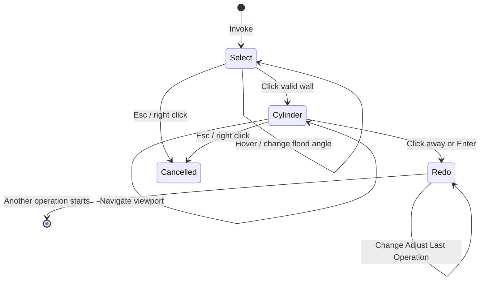

# Resize Hole workflow

Resize Hole is a blocking modal operator with two user-facing stages: selecting a cylindrical or conical wall and editing its available dimensions.

## State sequence

## 1. Invocation

`invoke()` verifies Edit Mesh mode, captures the original face selection, resets all transient state, finds the active viewport region, installs a `POST_PIXEL` draw handler, and registers the modal callback.

An existing selected face is used as an initial hover seed when possible. This lets the user see a preview even before the first mouse-move event arrives.

## 2. Hover selection

This step is analogous to selecting a face and then running Select -> Select Linked -> Linked Flat Faces and also setting the angle tolerance to some value that works well for the mesh.

Mouse movement calls `_update_hover()`:

1. Convert the region-space mouse coordinate to a world-space ray.
2. Ray-cast against a `BVHTree` built from the edit mesh.
3. Use the hit face as a flood-fill seed.
4. Traverse neighboring faces whose world-space normals differ by no more than `flood_angle`.
5. When missing faces split the wall, fit the connected patch provisionally and add disconnected faces only when their axial span, radius, and normal agree with that fitted circular cone.
6. Triangulate the candidate faces and store world-space preview triangles.

`[` and `]` adjust the flood angle. The preview is drawn after the 3D scene, so remains visible in a tinted manner when occluded by the mesh without enabling X-Ray mode.

## 3. Circular-cone fitting

This step mirrors the bundled **Fit Circular Cone** Geometry Nodes asset. A cylinder is the zero-slope case of the same model.

Clicking a valid candidate calls `_lock_selection_and_fit()`:

1. Gather selected-wall positions and area-weighted face normals.
2. Center the normals and use NumPy's compiled SVD/PCA to recover the axis direction. Circular-cone normals lie in a plane whose normal is the cone axis.
3. For every sample, form a meridional plane through its position with normal `axis × wall_normal`. Least-squares plane intersection recovers a point on the common axis even when angular samples are missing.
4. Project the mean wall position onto that axis to choose a numerically stable axis point.
5. Convert vertices to axial height and radial distance, then linearly regress radius on height. A significant slope with a low relative residual is classified as a cone; other fits remain cylinders so a chamfer is not mistaken for a taper.
6. Classify one-face boundary edges against the fitted cone generator. Generator-aligned edges are side defects caused by missing faces; the remaining circumferential fragments are merged into two axial end groups and fitted with SVD planes.
7. Select the minimum, average, or maximum radial estimate as the initial diameter baseline.
8. Capture original vertex coordinates and proportional-edit weights.
9. Build an ideal cone/cylinder GPU preview and enter the `CYLINDER` stage.

The estimator changes only the fitted radius. Axis and center still use all selected wall data, that way if, for example, a chamfer/bevel was included in the selection, it will also be scaled in the next step.

## 4. Live dimension editing

Numeric input updates the most recently touched dimension handle, defaulting to `diameter`. Diameter uses a horizontal handle; eligible depth uses a vertical handle below it. Dragging that handle down increases depth, while dragging it up decreases depth. Detected cones add a horizontal **Angle** handle. Angle input and stepping use degrees; the displayed value is the cone half-angle. The `+` and `-` shortcuts follow the same active-dimension rule.

Deformation is always recalculated from captured original coordinates, never from the previous preview result, so repeated edits do not accumulate numerical distortion.

When all available dimensions remain at their fitted values, execution restores those captured coordinates verbatim and skips all scaling and end-plane reprojection.

For every affected vertex:

1. Decompose its offset from the fitted axis point into axial and radial components.
2. Scale the axial coordinate away from the fixed top/model-side plane when depth changes.
3. Evaluate the target radius from the requested top diameter and signed cone slope at that target axial coordinate. Radial residuals from imperfect source geometry are preserved proportionally.
4. For selected boundary vertices, follow the target cone generator until it intersects the fitted end plane. With zero slope this is the former axis-parallel cylinder projection. It preserves skewed cuts while keeping the requested conic angle.
5. Blend original and target positions by the proportional-edit weight.

When the wall provides two recoverable end-arc groups and each is planar within the internal absolute/relative epsilon, the viewport and Redo panel expose **Depth**. Each circle center is its fitted plane's intersection with the cone axis, so the distance from the top/model-side center to the bottom center remains meaningful when the planes are not parallel or the arcs are incomplete.

Wall-normal direction distinguishes a stud from a hole. Adjacent-face normals then identify the end attached to the surrounding model: a hole chooses the face whose normal points away from the fitted region, while a stud reverses that test. For a cone, an ambiguous result falls back to the wider end, matching a conventional countersink. That top/model-side plane and proportional vertices beyond it stay fixed during depth changes. The other end translates along the cone axis and boundary vertices are reprojected along the target generators. Non-planar or insufficient end arcs simply omit Depth; diameter and detected conic angle remain editable.

For a cylindrical through-hole, the adjacent faces at both boundary loops point away from the wall. This classification suppresses Depth, leaving only diameter. A blind cylindrical hole has one inner adjacent face pointing back into the region, so it retains depth adjustment. A cone with two end arcs retains depth because the top-to-bottom distance and taper remain meaningful even when both rims are exposed.

The drag modifier behavior follows Blender's snap toggle:

- Global snapping off: Ctrl enables 0.1 mm increments.
- Global snapping on: dragging snaps by default and Ctrl temporarily disables it.
- Shift increases drag precision.

The mouse wheel, middle mouse button, trackpad pan/rotate/zoom gestures, and 3D mouse events pass through to Blender for viewport navigation. The overlay is reprojected as the view changes. Clicking the on-screen gizmo can begin another drag without leaving numeric-input mode.

The labels, drag handles, hit targets, drag sensitivity, and GPU line widths follow Blender's DPI-aware UI and pixel scales, so the interaction remains the same size on standard and high-density displays.

## 5. Commit, redo, and persistent preview

Clicking away from the gizmo or pressing Enter ends the modal session and calls `execute()`. Hidden operator properties contain the fitted axis, basis, center, radius estimates, slope/cone classification, diameter reference coordinate, face indices, serialized end planes, and optional depth-fit metadata required by Blender's redo system. Changing **Diameter Estimate** in Redo switches the fitted baseline and Diameter together, so the estimator change itself is a geometry no-op and later edits use that new baseline.

The operator's RNA object may be removed after execution. `_PersistentPreview` copies only plain Python coordinates, numeric text, and viewport references, then owns the draw handler while Resize Hole remains the last operation. Redo-panel changes rebuild the ideal cone/cylinder and refresh the overlay geometry and formatted dimension text.

## 6. Cancellation and cleanup

Esc or right click restores the original vertex coordinates and face selection before removing draw data. The same restoration happens if the active area stops being a 3D viewport. `unregister()` calls `cleanup_runtime()` so disabling the extension cannot leave viewport handlers behind.
