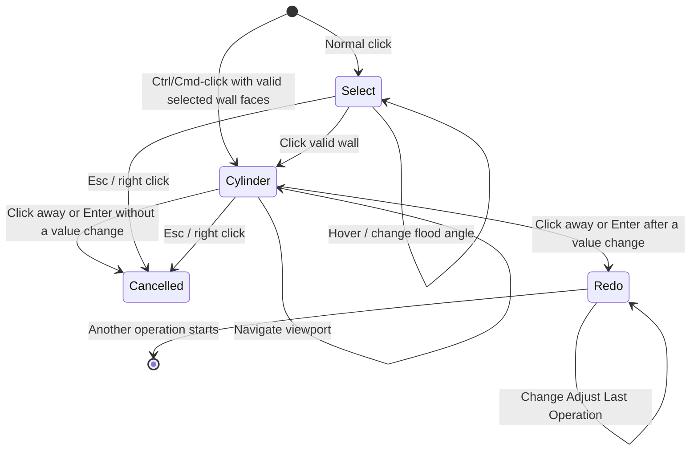

# Resize Hole workflow

Resize Hole is a blocking modal operator with two user-facing stages: selecting a cylindrical or conical wall and editing its available dimensions.

## State sequence

## 1. Invocation

`invoke()` verifies Edit Mesh mode, captures the original face selection, resets all transient state, finds the active viewport region, installs a `POST_PIXEL` draw handler, and registers the modal callback.

The sidebar's **Mode** dropdown below Diameter Estimate defaults to **Auto** and can preselect **Scaling** or **Boolean**. The button copies this scene setting into the operator's `resize_method`; invocation preserves it rather than resetting it to Auto. The same choice applies to normal hover picking and Ctrl/Cmd-click selection fitting, while the redo panel can override it independently. Both dropdowns use the same shared enum definition.

An existing selected face is used as an initial hover seed when possible. This lets the user see a preview even before the first mouse-move event arrives.

Ctrl-click (Windows/Linux) or Cmd-click (macOS) on **Resize Hole** bypasses hover selection and immediately calls `_lock_selection_and_fit()` with exactly the selected visible faces. It does not build a picking BVH, flood fill, or expand the wall selection. Empty selections or selections that cannot produce a stable cylinder/cone fit cancel with a warning instead of falling back to hover. A successful fit enters dimension editing without starting a drag or changing geometry; Escape restores the original selection, and confirming without changing a value remains a no-op.

## 2. Hover selection

Hidden faces are excluded from geometric working sets throughout resizing. Hover picking uses a visible-face BVH with an explicit mapping back to the source BMesh, so hidden faces cannot occlude a visible wall. The missing-face KD-tree, circular-cone/end-plane fits, projection BVHs, organic samples, and disposable fairing probes likewise omit hidden faces. Coordinate deformation excludes hidden-only vertices; visible vertices shared with hidden faces retain Blender's usual transform behavior. Cleanup does not expand into hidden support faces.

Exact Boolean does not respect Edit Mode visibility by itself. Reconstruction therefore detaches hidden geometry from the operand before native subtraction; the live display and cached reconstructed operand contain only visible geometry. Confirmation restores untouched hidden faces after all solver cleanup, preserving their hide state, material indices, supported custom data, and UVs. Surviving shared vertices reconnect by temporary source identity and exact position, not spatial proximity. The real mesh datablock retains its identity for native undo. Preservation snapshots, cheap visibility/count bookkeeping, and Blender's native mesh synchronization still involve the complete source; hidden geometry is never passed to the geometric fitting/search/Boolean algorithms.

This step is analogous to selecting a face and then running Select -> Select Linked -> Linked Flat Faces and also setting the angle tolerance to some value that works well for the mesh.

Mouse movement calls `_update_hover()`:

1. Convert the region-space mouse coordinate to a world-space ray.
2. Ray-cast against a `BVHTree` built from the edit mesh.
3. Use the hit face as a flood-fill seed.
4. Traverse neighboring faces whose world-space normals differ by no more than `flood_angle`.
5. When missing faces split the wall, fit the connected patch provisionally and add disconnected faces only when their axial span, radius, and normal agree with that fitted circular cone.
6. Triangulate the candidate faces and store world-space preview triangles.

`[` and `]` adjust the flood angle. The preview is drawn after the 3D scene, so remains visible in a tinted manner when occluded by the mesh without enabling X-Ray mode.

The read-only `SELECT` stage retains a session-local hover cache. World-normal transforms and adjacent-face dot products are computed once as needed. Connected components are memoized for the current flood angle and diameter estimator, along with their independently fitted missing-face extensions and preview triangles. Moving between faces in the same connected component does not repeat fitting, bridging, or tessellation; returning from another region or a ray miss restores its saved highlight. Faces added across a gap are not aliased to the seed component, since a seed on a different fragment must still produce its own provisional fit.

Missing-face searches lazily build a KD-tree of world-space face centers. A conservative sphere enclosing the fitted cone/cylinder's tolerated axial and radial extent narrows the candidates, then the original axial, radial, visibility, and normal tests decide membership. Flood-angle or estimator changes discard region results but reuse mesh-derived data. Mesh identity, element counts, and object transform are checked for invalidation; the blocking selection stage keeps geometry and visibility frozen. A fresh invocation, locking the wall, cancellation, or confirmation discards the cache. At most 32 fitted regions retain highlight geometry. Ray-casting still resolves the clicked face synchronously; selection is not delayed by a hover debounce.

## 3. Circular-cone fitting

This step mirrors the bundled **Fit Circular Cone** Geometry Nodes asset. A cylinder is the zero-slope case of the same model.

Clicking a valid candidate calls `_lock_selection_and_fit()`:

1. Gather selected-wall positions and area-weighted face normals.
2. Center the normals and use NumPy's compiled SVD/PCA to recover the axis direction. Circular-cone normals lie in a plane whose normal is the cone axis.
3. For every sample, form a meridional plane through its position with normal `axis × wall_normal`. Least-squares plane intersection recovers a point on the common axis even when angular samples are missing.
4. Project the mean wall position onto that axis to choose a numerically stable axis point.
5. Convert vertices to axial height and radial distance, then linearly regress radius on height. A significant slope with a low relative residual is classified as a cone; other fits remain cylinders so a chamfer is not mistaken for a taper.
6. Classify one-face boundary edges against the fitted cone generator. Generator-aligned edges are side defects caused by missing faces; the remaining circumferential fragments are merged into two axial end groups and fitted with SVD planes.
7. For every unbranched wall-to-base boundary or boundary fragment, run the Fair Hole support-surface cascade on the adjacent non-wall faces. Plane, cone/cylinder, sphere, and organic hypotheses classify the reconstruction surface. Adjacent vertices, rather than face centroids, determine whether a support extends radially away from the fitted wall; inward support identifies old blind-hole cavity geometry. Smooth neighboring faces provide a wider sample for curved fits, while the direct-deformation check uses a strict planarity tolerance so a narrow spherical band is not mistaken for a plane.
8. Snapshot all non-wall faces in a world-space base-surface BVH.
9. Select the minimum, average, or maximum radial estimate as the initial diameter baseline. For a cylindrical hole, use the corresponding wall-plane clearance instead of the distance to polygon corner vertices, whether or not depth controls are available.
10. Capture original vertex coordinates and proportional-edit weights.
11. Build an ideal cone/cylinder GPU preview and enter the `CYLINDER` stage.

The estimator changes only the fitted radius. Axis and center still use all selected wall data, that way if, for example, a chamfer/bevel was included in the selection, it will also be scaled in the next step.

### Polygonal cylindrical-hole diameter

A cylindrical hole's Diameter is the diameter of the circular gauge fitting between its flat wall facets. This applies to both blind and through-holes, including fits without usable depth controls. Wall-plane clearances provide the Minimum, area-weighted Average, and Maximum estimates, ignoring extra collinear vertices on those facets. For a regular source polygon with `Ns` sides and vertex radius `Rs`, its inside radius is `r = Rs × cos(π/Ns)`. Direct scaling retains the source polygonization and uses `Rs = r / cos(π/Ns)` internally, so accepting the initial diameter leaves all vertices unchanged. The source side count is inferred from distinct wall-normal directions and remains serialized independently of Boolean Segments. Legacy partial fits without serialized source resolution keep their original convention rather than changing interpretation during projection setup.

An actual `N`-sided Boolean cutter instead uses vertex radius `r / cos(π/N)`, or equivalently the source-convention target radius multiplied by `cos(π/Ns) / cos(π/N)`. This applies to both final cutters and the actual live-preview segment override. Keeping the same side count preserves the previous cutter radius; fewer sides need a larger vertex radius to retain the same clearance. The blue overlay is an independent smooth circular gauge at radius `r`, never the enlarged cutter's vertex radius. Its fixed 128 segments never participate in the cutter correction. Redo resolution changes and fresh invocations preserve the measured inside diameter, even when a blind hole becomes a through-hole. Cone and stud dimensions retain their existing conventions. A cylinder's perpendicular wall normals prevent uneven Boolean vertex samples from being mistaken for a conical taper.

A coaxial cone attached to the smaller end of a cylindrical bore is classified independently of the generic fairing hypothesis. Auto can scale that bore directly: its shared cone rim slides along the hole axis to preserve the cone slope, and any intermediate cone rows redistribute along their generators while the larger exterior rim stays fixed. Both enlargements and shrinkages use this same source-coordinate deformation. If the requested bore consumes the entire cone or runs its shared rim into the other bore end, Auto switches to reconstruction. Explicit Scaling still overrides that check.

## 4. Live dimension editing

Live handle drags ignore unchanged values, including snap plateaus and repeated values rounded by Blender's FloatProperty storage. Mesh updates are coalesced to at most 30 Hz, keeping only the newest dimensions while the smooth blue gauge and numeric label follow changed input immediately. A drag timer delivers a pending update when the pointer pauses; mouse release bypasses the rate limits and flushes the latest value. Boolean solver updates retain their separate 0.5-second throttle, including a trailing update on a held-pointer pause. Cancellation discards pending work, and confirmation uses the normal full-quality execute path. Timers are removed on release, cancellation, confirmation, and extension cleanup.

During a coordinate-only drag, `_resolve_resize_wall_faces()` reuses a previously verified wall rather than hashing the full mesh on every update. The cache is scoped to that drag and checks BMesh identity, element counts, locked selection, and face validity. Source restoration, reconstruction, topology-changing conic connections, and redo invalidate it; starting another drag validates connectivity again. Final execution retains the full source-topology and stale-index safeguards.

Numeric input updates the most recently touched dimension handle. Cylinders default to `diameter`; eligible blind cylinders also expose physical hole depth. A detected cone with two recoverable end circles instead defaults to theoretical apex **Depth** and exposes **Truncated Depth** plus the full included **Conic Angle** at the theoretical tip. Truncated Depth is the physical axial distance from the outer/model-side circle to the small end circle, whether that circle borders a flat cap or opens into a continuing cylindrical bore such as a countersink. The outer radius is `Depth × tan(Angle / 2)`, and the small radius is `(Depth - Truncated Depth) × tan(Angle / 2)`. Changing either Depth or Truncated Depth moves the other by the same delta, keeping `Depth - Truncated Depth` and therefore the small-circle radius fixed. Changing only Conic Angle preserves that small bottom circle's axial position and radius by updating apex Depth to `Truncated Depth + Bottom Radius / tan(Angle / 2)`; the cone therefore pivots around the bottom edge instead of moving it. Geometry evaluation additionally anchors the cone at the originally fitted small-circle radius and resolves the edited dimension independently of RNA callback order: an Angle edit or explicit Truncated Depth edit uses the truncation plane directly, while a lone Depth edit derives that plane as `Depth - Bottom Radius / tan(Angle / 2)`. This keeps all three controls responsive in Scaling, Exact Boolean, live preview, and redo without resizing the connected bore. Truncated Depth is clamped to Depth for geometry evaluation. Angle input and stepping use degrees. The `+` and `-` shortcuts follow the active-dimension rule.

For single-plane holes, deformation is always recalculated from captured original coordinates, never from the previous preview result, so repeated edits do not accumulate numerical distortion. Multi-plane and curved holes keep the real source object's topology pristine during modal adjustment and show a reversible Exact Boolean result. Sources with at most 32 detected angular segments use that final resolution live; larger sources use a 32-sided preview cutter. The first Boolean preview reconstructs and fairs the exterior opening once, transfers that cutter-free reconstruction exclusively to a separate display object, and immediately restores an untouched source copy to the real edit object before hiding it. This prevents Blender's undo/redo input from becoming the reconstructed cap. The display object holds one unapplied Exact Boolean modifier, and later live updates reuse its mesh, modifier, cutter object, and cutter mesh, mutating only the cutter geometry without rerunning fairing, applying the modifier, swapping the edited source mesh, or performing final simplification. Confirmation or cancellation removes the display and cutter and shows the pristine edit object again; confirmation then uses the source mesh's detected angular resolution and performs final cleanup. The estimator projects wall-face normals perpendicular to the fitted axis, deduplicates their angles, and divides a full turn by the median cyclic gap. Face normals make the estimate independent of extra rim vertices and axial subdivisions, while the median gap tolerates missing wall faces. During handle dragging, cutter updates are throttled to one every 0.5 seconds while the lightweight GPU overlay follows every pointer event. Mouse release forces one trailing update when a newer drag value is pending.

When all available dimensions remain at their fitted values, execution restores those captured coordinates verbatim and skips all scaling and surface reprojection. Selection-click jitter does not start dimension editing or snapping: a drag must first cross a three-pixel threshold, scaled upward for high-DPI displays. The selecting click uses the default visible dimension, Depth for an adjustable conic and Diameter for a cylinder. A drag returned exactly to its origin restores its original unsnapped value.

A conic with a coaxial continuing bore at its small end and a planar exterior at its large end uses Auto Scaling while that exterior remains planar. Sparse planar fan topology alone does not force these countersinks into Boolean reconstruction; actual departure from the exterior plane still does. Conic dimension edits preserve the continuing cylindrical bore's radius. Exterior-rim projection stays anchored to the original support plane during depth edits, including when the fitted axis is slightly misaligned with that plane; depth translation is applied only to the independently fitted blind cap. This keeps repeated invocations from warping the planar support and incorrectly switching Auto to Boolean.

Direct deformation and coordinate restoration refresh BMesh normals before returning, so the next invocation fits the geometry now visible in Edit Mode. In particular, a cone changed to 0° joins its continuing cylinder in the next wall flood instead of retaining the old cone/bore normal discontinuity. Before copying a fresh Boolean preview source, a reconstruction rollback mesh, or a shortened-cone connector source, synchronize the object's mesh datablock from Edit Mode. BMesh display updates alone do not guarantee that `obj.data.copy()` includes the preceding operation's coordinates; copying an unsynchronized datablock can resurrect the old countersink.

Setting Diameter or an available Depth to exactly zero closes the hole using the shared Fair Hole pipeline instead of collapsing vertices or subtracting a degenerate cutter. This also closes both ends of a through-hole and includes a recognized connected countersink/bore in the cavity removal. The redo panel exposes reconstruction fit, topology, and simplification controls for this operation regardless of Resize Method. Live closure uses a separate fair-surface display with an untouched source mesh, so cancellation, entering a positive value again, and redo remain reversible. Zero Truncated Depth is not a close request: it places the small conic circle at the top while retaining its cylindrical connection.

Zero Conic Angle is also not a close request: it removes the taper and continues the fitted small-circle radius as a straight cylinder, leaving a connected through-hole open. The hidden Diameter value cannot request closure while the three conic controls are active. Because a zero-angle cylinder has no finite theoretical apex, the finite depth controls are retained while the angle is zero; entering a positive angle again reconstructs apex Depth from the stored bottom-circle radius and Truncated Depth. Live angle-only Boolean updates change only the cutter, leaving the retained bore junction coordinates untouched; redundant world/local coordinate conversion can otherwise introduce rounding differences between coplanar polygons and make the zero-angle subtraction lose wall faces.

For a cone whose smaller end exits through a second exterior surface, reducing Depth or Truncated Depth retains a connection from the new small circle to the original exit surface at the fixed small-circle radius. Auto uses Exact Boolean for this topology change; the compound cutter ends just beyond the original exit rather than extending through unrelated remote geometry. Explicit Scaling inserts a cylindrical strip, keeping the original exit boundary and building each preview from the pristine source so repeated drags cannot accumulate rings. Returning to the original dimensions restores the original topology.

When every closed exterior support is exactly one plane, each affected vertex is handled directly:

1. Decompose its offset from the fitted axis point into axial and radial components.
2. Scale the axial coordinate away from the fixed top/model-side plane when depth changes.
3. For a cylinder, evaluate target radius from the requested top diameter. For a cone, derive the outer radius and signed slope from apex Depth and half of the included tip angle, then evaluate the radius at the target axial coordinate. Radial residuals from imperfect source geometry are preserved proportionally.
4. For an enlarged radius, project an exterior rim along the hole axis onto the frozen base mesh. A blind-cap rim instead intersects its independently fitted cap surface, preventing it from snapping to the exterior plane. Before direct deformation, probe the complete target rim against that frozen mesh. A 0.05%-of-span positional tolerance, a 2° normal tolerance, and a multi-probe vote suppress isolated BVH seams and ordinary mesh noise. If the required probes leave the original support plane, switch to Boolean reconstruction. Auto also switches when a large enlargement would stretch sparse planar fan edges more than four rim samples away from the bore. This catches planar collars whose surrounding cap becomes genuinely sloped or curved and avoids changing triangulation far from the requested hole.
5. For a reduced radius, first inset the vertex radially, then intersect its single fitted plane along the hole axis.
6. If no plane intersection exists, follow the target cone generator to the fitted end plane as a conservative fallback.
7. Apply depth translation to the blind-cap projection, keeping the exterior support fixed, then blend original and target positions by the proportional-edit weight.

### Boolean reconstruction

If any exterior support is two or three planes, spherical, conic/cylindrical, or organic, confirmation takes a transactional reconstruction path:

1. Copy the source mesh datablock as a rollback snapshot.
2. Remove the selected old wall, flood the complete blind-cap face region bounded by that wall, and remove any remaining faces inside the original radial/axial cavity envelope. The exterior reconstruction patch is blocked from this deletion flood. Walking the complete cap prevents dense, sloped, or dished original bottoms from returning as a large floating surface after shrinking or changing Redo depth. The accepted exterior support patch is also protected when curved face centers lie inside the envelope.
3. Rediscover each resulting boundary from its protected support patch instead of retaining destructive-edit BMesh edge references, then run the existing closed-surface preparation, refit, and patch-construction pipeline shared with Fair Hole's analytic repairs. Fair Hole's new Grid preparation and row-fill stages are intentionally separate from this reconstruction lifecycle. This includes the 0.1° rim simplification, boundary-inclusive sphere/cylinder dissolve for their default topology or a spoke-protecting Grid rim pass, source-edge sampling and spatial cross-field quadrangulation for Grid fills, thin-plate depth solve, and analytic projection. The hypothesis accepted from the intact support patch remains authoritative during reconstruction; only sphere and cylinder are refitted after their boundary-inclusive dissolve changes the samples. This prevents a reduced post-delete rim from reclassifying and bending a known planar surface. The shared finalizer welds the reconstruction and dissolves compatible former Grid rim edges, but defers its optional expanded dissolve because the temporary radial/grid subdivisions make Exact Boolean more reliable. Every generated fair-surface face receives a distinct temporary material because Exact Boolean coalesces empty material slots and can zero generic face-attribute values; the original index-zero slot is reserved even on meshes with no materials. The post-Boolean pass also rejects every face lying on the cutter so solver-generated walls or caps cannot masquerade as fairing. When final simplification is enabled, it selects every remaining fair-surface face, calls `mesh.select_more(use_face_step=True)` exactly once, subtracts the cutter-derived faces, switches to edge-selection context, and runs a boundary-inclusive 0.1° Limited Dissolve before restoring the user's selection mode. This covers the entire fair patch and one exterior connected face ring, but clips the resulting edge selection to a cylindrical neighborhood around the bore. A huge adjacent triangle can therefore contribute its local former-rim edge without carrying the dissolve along a spoke into a remote part of the model. The cleanup deliberately omits the `NORMAL` delimiter because Boolean split-loop normals otherwise preserve every coplanar radial and concentric seam as a spider web; the geometric angle retains actual surface breaks. Original material indices are restored and all temporary slots are removed whether simplification is enabled or disabled.
4. Build a capped circular-cone cutter from the requested dimensions. Cylinders use diameter and physical depth; cones use apex Depth, Truncated Depth, and the included tip angle. The wider conic end extends beyond the reconstructed exterior by the local Boolean-clearance margin. For a compatible coaxial bore, preserve its original faces and vertices, move its junction ring to the requested truncation coordinate, and temporarily cap it before subtraction. The cone cutter follows that ring's actual angular samples and tapers inward immediately below the cap, opening the cap without re-cutting the existing cylinder. A different requested cutter resolution adds one short transition strip at the junction, keeping the bore's original facet phase and subdivisions below it. The cached live operand moves the same tagged junction vertices when depth or segment count changes; those indices belong only to that unchanged operand, never a Boolean result. If the edit consumes the next cylinder row, reconstruct from the pristine source using the general compound cutter with adaptive radial clearance, radius restoration, and local welding. Repeated reconstruction welds nearly coincident samples only on the recovered mouth boundary before fairing. Normal through-hole cutters extend only beyond their detected bore mouths, rather than through unrelated remote geometry elsewhere on the object.
5. Apply Blender's Exact Boolean Difference. When blind depth is unchanged, limited-dissolve the coplanar cutter splits in the hole's base while preserving its perimeter. Remove the temporary cutter and return to Edit Mode.

For a reconstructed blind hole, the fixed depth basis is the intersection of the fitted hole axis with the accepted exterior reconstruction surface. The other endpoint is the axis intersection with the independently fitted blind-cap surface. Their initial distance is exposed as **Depth** even when the exterior is spherical, conic, organic, or split across two or three planes. Editing Depth moves only the cutter's inner endpoint; the reconstruction-surface basis remains fixed. Through-holes have no interior cap surface and continue to omit Depth.

Any failure restores the backup mesh. Non-planar reconstruction without a closed exterior rim is rejected rather than falling back to unsafe rim deformation. Once an enlargement leaves its initial one-plane collar and selects Boolean reconstruction, that decision is latched for the remainder of the interaction. Small drag fluctuations around the transition radius therefore cannot alternate between direct deformation and the Exact Boolean preview.

The Resize Hole redo panel exposes a Resize Method override: **Auto**, **Scaling**, or **Exact Boolean**. Auto retains the support-surface decision and its latched planar-to-curved transition; Scaling suppresses reconstruction and uses direct fitted-wall deformation; Exact Boolean forces reconstruction even on a planar case. A resolved Scaling path exposes a separate **Final Simplify** toggle that defaults off. When enabled for a shrink, it grows the resized wall selection once and runs the 0.1° Limited Dissolve cleanup; coordinate deformation and required mesh updates still occur when it is disabled. When Boolean is active, the panel instead exposes cutter segment count, Reconstruction Fit followed by Reconstruction Topology, circle-loop count, C2-curvature matching, and its independently default-enabled final simplification. The cutter segment count initially matches the detected source angular resolution and can be overridden from 3 to 512. These controls feed the existing closed-surface fairing lifecycle. At modal confirmation, `_PersistentPreview` retains a canonical copy of the pre-preview mesh; direct-preview vertex coordinates are normalized back to their captured originals before that copy is made. Every redo execution restores this canonical mesh before discarding cached preview and mesh-derived state, restoring the serialized source fit, and applying the requested values. This avoids compounding direct deformation and prevents a preceding Boolean result or old blind cap from becoming redo input even when Blender's undo stack restores an intermediate mesh. Source element counts and a canonical face-connectivity fingerprint are serialized with the fit as an additional validation layer, so the original face indices remain authoritative whenever the source topology is present, including imperfect walls that do not pass an ideal coaxial test. The fingerprint distinguishes a preceding Boolean result even when it coincidentally has exactly the same vertex, edge, and face counts as the source. In that case the operator rediscovers a wall component whose normals agree with the fitted cylinder or cone before reconstruction, preventing adjacent support slivers and the previous blind cap from entering the selection.

An explicit Resize Method remains authoritative throughout fitting, preview reuse, and redo execution. Choosing Scaling retires any cached Boolean preview immediately on evaluation and clears its pending updates. Only Auto evaluates and latches planar-to-nonplanar transitions; neither an automatic support classification nor retained preview state can override Scaling or Exact Boolean. The panel reflects the requested mode as soon as it is selected, even when the resulting geometry is imperfect.

When a cylindrical wall provides two recoverable end-arc groups and each is planar within the internal absolute/relative epsilon, the viewport and Redo panel expose physical **Depth**. For a cone, the boundary groups' mean axial coordinates initialize **Truncated Depth**, while the fitted outer radius and slope extrapolate **Depth** to the theoretical apex. Using axial boundary coordinates keeps a reconstructed countersink adjustable when an Exact Boolean leaves a slightly corrugated or triangulated cone-to-bore seam. End-plane angles below 0.4° are treated as parallel. Cylindrical circle centers remain the fitted planes' intersections with the bore axis, so their parameters remain meaningful when the planes are not parallel or the arcs are incomplete.

Wall-normal direction distinguishes a stud from a hole. Adjacent-face normals then identify the end attached to the surrounding model: a hole chooses the face whose normal points away from the fitted region, while a stud reverses that test. A cone always uses its wider circle as the top/model-side end because the smaller end's adjacent normal may belong to a continuing cylindrical bore. That top/model-side plane and proportional vertices beyond it stay fixed during direct depth changes. The other end translates along the cone axis and boundary vertices are reprojected along the target generators. Reconstruction uses the fitted-surface intersections described above instead of requiring planar end arcs.

For a cylindrical through-hole, the adjacent faces at both boundary loops point away from the wall. This classification suppresses Depth, leaving only diameter. A blind cylindrical hole has one inner adjacent face pointing back into the region, so it retains depth adjustment. A cone with two end arcs retains conic dimensions because its theoretical apex depth, physical truncation depth, and included tip angle remain meaningful even when both rims are exposed.

The drag modifier behavior follows Blender's snap toggle:

- Global snapping off: Ctrl enables 0.1 mm increments.
- Global snapping on: dragging snaps by default and Ctrl temporarily disables it.
- Shift increases drag precision.

The mouse wheel, middle mouse button, trackpad pan/rotate/zoom gestures, and 3D mouse events pass through to Blender for viewport navigation. The overlay is reprojected as the view changes. Clicking the on-screen gizmo can begin another drag without leaving numeric-input mode.

The labels, drag handles, hit targets, drag sensitivity, and GPU line widths follow Blender's DPI-aware UI and pixel scales, so the interaction remains the same size on standard and high-density displays.

The blue cylinder/cone overlay always uses 128 angular segments, including for through-holes and studs. Its smoothness is independent of the source mesh, live Boolean preview resolution, and final Boolean Segments setting; actual cutter and output-mesh topology remain unchanged.

## 5. Commit, redo, and persistent preview

Clicking away from the gizmo or pressing Enter after changing a dimension ends the modal session and calls `execute()`. The fitted dimensions are snapshotted when the wall is locked; if the available controls still match that baseline, confirmation instead restores the original geometry and face selection and returns `CANCELLED`, producing neither a mesh edit nor a redo entry. For an adjustable conic, only Depth, Truncated Depth, and Conic Angle count as edits; its hidden Diameter is not an independent fourth control. This is value-based, so moving a handle and returning it to its initial value is also a no-op. Hidden operator properties contain the fitted axis, basis, center, radius estimates, slope/cone classification, diameter reference coordinate, face indices, serialized end planes, and optional depth-fit metadata required by Blender's redo system. Changing **Diameter Estimate** for a cylinder switches the fitted baseline and Diameter together. Conic redo state additionally retains the initial theoretical apex and physical truncation depths; its visible dimensions do not expose Diameter as an independent constraint.

The operator's RNA object may be removed after execution. `_PersistentPreview` owns the canonical redo-source snapshot along with plain Python overlay coordinates, numeric text, and viewport references, then owns the draw handler while Resize Hole remains the last operation. Its Python-owned BMesh remains authoritative if Blender invalidates temporary mesh datablocks during undo. Redo-panel changes restore its contents into the existing real mesh ID, rebuild the ideal cone/cylinder, and refresh the overlay geometry and formatted dimension text. Source restoration, Boolean/Scaling preview transitions, and reconstruction rollback use `mesh_state.restore_mesh_contents()` rather than replacing `obj.data` and deleting its predecessor: native Edit Mode undo retains mesh identities even when their user counts reach zero. Display objects own detached copies of reconstructed operands, so restoring the real mesh never changes the displayed fair surface.

## 6. Cancellation and cleanup

Esc or right click restores pristine contents into the existing mesh datablock when a live Boolean preview exists; direct mode restores the original vertex coordinates and normals. Face selection is then restored before draw data is removed. The same restoration happens if the active area stops being a 3D viewport. A `ModalSession` owns the live operator and its original UI context only until cancellation or confirmation. `unregister()` calls `cleanup_runtime()`, which cancels live sessions before removing timers and drawing: temporary Boolean objects and snapshots are released and the real source object is unhidden. Cancellation is idempotent, and late queued modal events terminate without touching released state. Completed operators are not retained by the session registry; redo drawing keeps its separate plain-Python owner.

## Shared reconstruction fill

Boolean reconstruction uses the same Manhattan preparation and fill pipeline as Fair Hole, including one fixed post-mirror refinement pass and surface-aware relaxation of interior and unpinned refined-rim vertices. Grid honors Reconstruction Fit independently of topology: Sphere, cylinder/cone, and N-Plane use analytic projection. Organic Circle and Grid share a frozen evaluator captured before output construction: well-conditioned charts use default-enabled C2 matching with thin-plate fallback, while folded/grazing support uses a 3D minimum-bending reference rather than an unstable scalar height fit. The latter is approximate continuation, not exact C2 matching, and never subdivides source/output edges for its private reference. Auto attempts Grid for spherical/organic supports, falling back to five circle rings when a complete grid is infeasible; the failed attempt cannot alter the input boundary. Explicit Grid reports errors without fallback. Plane and cylinder Auto paths retain their specialized topology. There is no native or cross-field backend, grid-density control, or staged partial Boolean operand.
