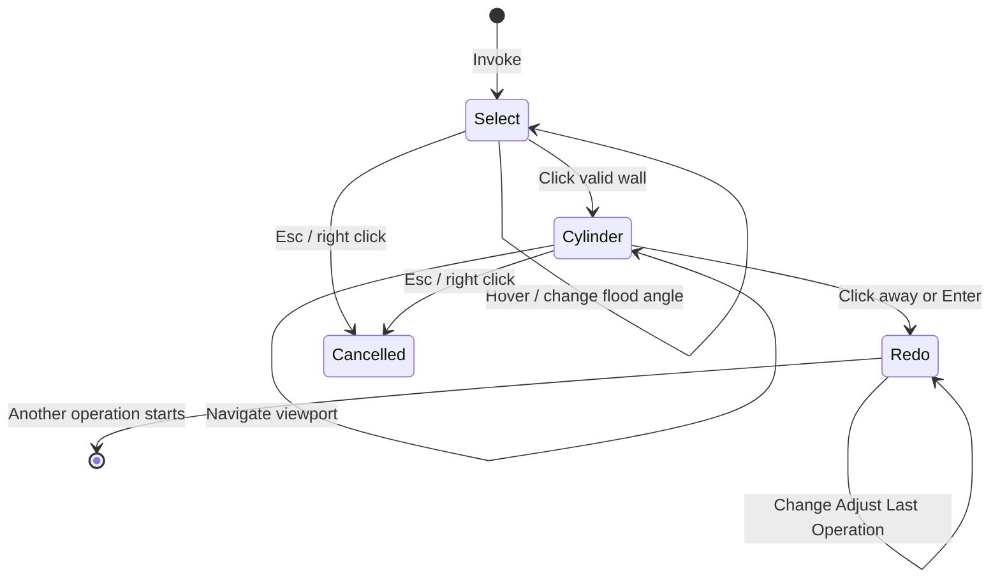

# Resize Hole workflow

Resize Hole is a blocking modal operator with two user-facing stages: selecting a cylindrical wall and editing its available dimensions.

## State sequence

## 1. Invocation

`invoke()` verifies Edit Mesh mode, captures the original face selection, resets all transient state, finds the active viewport region, installs a `POST_PIXEL` draw handler, and registers the modal callback.

An existing selected face is used as an initial hover seed when possible. This lets the user see a preview even before the first mouse-move event arrives.

## 2. Hover selection

This step is analogous to selecting a face and then running Select -> Select Linked -> Linked Flat Faces and also setting the angle tolerance to some value that works well for the mesh.

Mouse movement calls `_update_hover()`:

1. Convert the region-space mouse coordinate to a world-space ray.
2. Ray-cast against a `BVHTree` built from the edit mesh.
3. Use the hit face as a flood-fill seed.
4. Traverse neighboring faces whose world-space normals differ by no more than `flood_angle`.
5. Triangulate the candidate faces and store world-space preview triangles.

`[` and `]` adjust the flood angle. The preview is drawn after the 3D scene, so remains visible in a tinted manner when occluded by the mesh without enabling X-Ray mode.

## 3. Cylinder fitting

In this step we estimate the axis and position of a cylinder that contains the hole. We use singular value decomposition to find the axis and least squares circle fitting to find the x-y origin of that axis where x and y are specified as a coordinates orthoganol to the axis found by SVD.

Clicking a valid candidate calls `_lock_selection_and_fit()`:

1. Gather unique selected-wall vertices and area-weighted face normals.
2. Use NumPy's compiled SVD to find the axis with the smallest normal variation.
3. Build an orthogonal radial basis around that axis.
4. Solve an algebraic 2D circle fit for the radial center.
5. Select the minimum, average, or maximum radial distance as the initial radius.
6. Fit boundary planes with SVD for each connected end loop and record their scale-aware maximum point-to-plane residual and adjacent-face normal.
7. Capture original vertex coordinates and proportional-edit weights.
8. Build an ideal-cylinder GPU preview and enter the `CYLINDER` stage.

The estimator changes only the fitted radius. Axis and center still use all selected wall data, that way if, for example, a chamfer/bevel was included in the selection, it will also be scaled in the next step.

## 4. Live dimension editing

Numeric input updates the most recently touched dimension handle, defaulting to `diameter`. Diameter uses a horizontal handle; eligible depth uses a vertical handle below it. The `+` and `-` shortcuts follow the same active-dimension rule.

Deformation is always recalculated from captured original coordinates, never from the previous preview result, so repeated edits do not accumulate numerical distortion.

When both dimensions remain at their fitted values, execution restores those captured coordinates verbatim and skips all scaling and end-plane reprojection.

For every affected vertex:

1. Decompose its offset from the fitted center into axial and radial components.
2. Scale the radial component by `diameter / fitted_diameter` and, when depth is available, scale the axial coordinate away from the fixed outer/model-side plane.
3. For selected boundary vertices, slide the result along the cylinder axis until it intersects the fitted end plane. This preserves skewed end cuts, otherwise if you had, for example, a tube cut at 45 and scaled it, the angle at the end would not be 45 degrees relative to the tube axis after scaling.
4. Blend original and target positions by the proportional-edit weight.

When the wall has exactly two end loops and each is planar within the internal absolute/relative epsilon, the viewport and Redo panel expose **Depth**. Each circle's midpoint is its fitted plane's intersection with the cylinder axis, so the distance between those midpoints remains meaningful when the planes are not parallel.

Wall-normal direction distinguishes a stud from a hole. Adjacent-face normals then identify the loop attached to the surrounding model: a hole chooses the face whose normal points away from the cylindrical region, while a stud reverses that test. That outer/model-side plane and proportional vertices beyond it stay fixed during depth changes. The other end translates along the cylinder axis and boundary vertices are reprojected to its original plane orientation. Missing or ambiguous adjacent faces use stable boundary ordering as a fallback. Non-planar or incomplete boundaries simply omit Depth; diameter editing continues normally.

For a through-hole, the adjacent faces at both boundary loops point away from the cylindrical region. This classification suppresses Depth entirely, leaving only the diameter handle and Redo field. A blind hole has one inner adjacent face pointing back into the cylindrical region, so it retains depth adjustment.

The drag modifier behavior follows Blender's snap toggle:

- Global snapping off: Ctrl enables 0.1 mm increments.
- Global snapping on: dragging snaps by default and Ctrl temporarily disables it.
- Shift increases drag precision.

The mouse wheel, middle mouse button, trackpad pan/rotate/zoom gestures, and 3D mouse events pass through to Blender for viewport navigation. The overlay is reprojected as the view changes. Clicking the on-screen gizmo can begin another drag without leaving numeric-input mode.

The labels, drag handles, hit targets, drag sensitivity, and GPU line widths follow Blender's DPI-aware UI and pixel scales, so the interaction remains the same size on standard and high-density displays.

## 5. Commit, redo, and persistent preview

Clicking away from the gizmo or pressing Enter ends the modal session and calls `execute()`. Hidden operator properties contain the fitted axis, basis, center, all three radius estimates, face indices, serialized end planes, and optional depth-fit metadata required by Blender's redo system. Changing **Diameter Estimate** in Redo switches the fitted baseline and Diameter together, so the estimator change itself is a geometry no-op and later diameter edits use that new baseline.

The operator's RNA object may be removed after execution. `_PersistentPreview` copies only plain Python coordinates, numeric text, and viewport references, then owns the draw handler while Resize Hole remains the last operation. Redo-panel changes rebuild the ideal cylinder and refresh both the overlay geometry and formatted dimension text.

## 6. Cancellation and cleanup

Esc or right click restores the original vertex coordinates and face selection before removing draw data. The same restoration happens if the active area stops being a 3D viewport. `unregister()` calls `cleanup_runtime()` so disabling the extension cannot leave viewport handlers behind.
