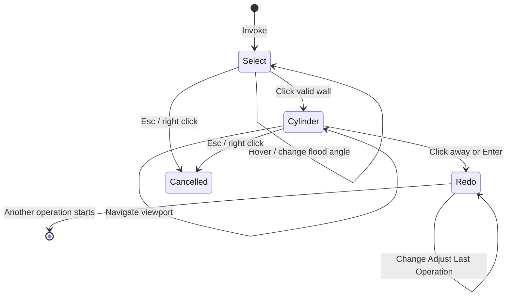

# Resize Hole workflow

Resize Hole is a blocking modal operator with two user-facing stages: selecting a cylindrical or conical wall and editing its available dimensions.

## State sequence

## 1. Invocation

`invoke()` verifies Edit Mesh mode, captures the original face selection, resets all transient state, finds the active viewport region, installs a `POST_PIXEL` draw handler, and registers the modal callback.

An existing selected face is used as an initial hover seed when possible. This lets the user see a preview even before the first mouse-move event arrives.

## 2. Hover selection

This step is analogous to selecting a face and then running Select -> Select Linked -> Linked Flat Faces and also setting the angle tolerance to some value that works well for the mesh.

Mouse movement calls `_update_hover()`:

1. Convert the region-space mouse coordinate to a world-space ray.
2. Ray-cast against a `BVHTree` built from the edit mesh.
3. Use the hit face as a flood-fill seed.
4. Traverse neighboring faces whose world-space normals differ by no more than `flood_angle`.
5. When missing faces split the wall, fit the connected patch provisionally and add disconnected faces only when their axial span, radius, and normal agree with that fitted circular cone.
6. Triangulate the candidate faces and store world-space preview triangles.

`[` and `]` adjust the flood angle. The preview is drawn after the 3D scene, so remains visible in a tinted manner when occluded by the mesh without enabling X-Ray mode.

## 3. Circular-cone fitting

This step mirrors the bundled **Fit Circular Cone** Geometry Nodes asset. A cylinder is the zero-slope case of the same model.

Clicking a valid candidate calls `_lock_selection_and_fit()`:

1. Gather selected-wall positions and area-weighted face normals.
2. Center the normals and use NumPy's compiled SVD/PCA to recover the axis direction. Circular-cone normals lie in a plane whose normal is the cone axis.
3. For every sample, form a meridional plane through its position with normal `axis × wall_normal`. Least-squares plane intersection recovers a point on the common axis even when angular samples are missing.
4. Project the mean wall position onto that axis to choose a numerically stable axis point.
5. Convert vertices to axial height and radial distance, then linearly regress radius on height. A significant slope with a low relative residual is classified as a cone; other fits remain cylinders so a chamfer is not mistaken for a taper.
6. Classify one-face boundary edges against the fitted cone generator. Generator-aligned edges are side defects caused by missing faces; the remaining circumferential fragments are merged into two axial end groups and fitted with SVD planes.
7. For every unbranched wall-to-base boundary or boundary fragment, run the Fair Hole support-surface cascade on the adjacent non-wall faces. Plane, cone/cylinder, sphere, and organic hypotheses classify the reconstruction surface. Adjacent vertices, rather than face centroids, determine whether a support extends radially away from the fitted wall; inward support identifies old blind-hole cavity geometry. Smooth neighboring faces provide a wider sample for curved fits, while the direct-deformation check uses a strict planarity tolerance so a narrow spherical band is not mistaken for a plane.
8. Snapshot all non-wall faces in a world-space base-surface BVH.
9. Select the minimum, average, or maximum radial estimate as the initial diameter baseline.
10. Capture original vertex coordinates and proportional-edit weights.
11. Build an ideal cone/cylinder GPU preview and enter the `CYLINDER` stage.

The estimator changes only the fitted radius. Axis and center still use all selected wall data, that way if, for example, a chamfer/bevel was included in the selection, it will also be scaled in the next step.

## 4. Live dimension editing

Numeric input updates the most recently touched dimension handle, defaulting to `diameter`. Diameter uses a horizontal handle; eligible depth uses a vertical handle below it. Dragging that handle down increases depth, while dragging it up decreases depth. Detected cones add a horizontal **Angle** handle. Angle input and stepping use degrees; the displayed value is the cone half-angle. The `+` and `-` shortcuts follow the same active-dimension rule.

For single-plane holes, deformation is always recalculated from captured original coordinates, never from the previous preview result, so repeated edits do not accumulate numerical distortion. Multi-plane and curved holes retain a pristine source-mesh snapshot during modal adjustment and show a reversible 16-sided Exact Boolean result. Every update starts again from that snapshot; confirmation uses the source mesh's detected angular resolution. The estimator projects wall-face normals perpendicular to the fitted axis, deduplicates their angles, and divides a full turn by the median cyclic gap. Face normals make the estimate independent of extra rim vertices and axial subdivisions, while the median gap tolerates missing wall faces. During handle dragging, expensive Boolean rebuilds are throttled to one every 0.5 seconds while the lightweight GPU cutter follows every pointer event. Mouse release forces one trailing rebuild when a newer drag value is pending.

When all available dimensions remain at their fitted values, execution restores those captured coordinates verbatim and skips all scaling and surface reprojection.

When every closed exterior support is exactly one plane, each affected vertex is handled directly:

1. Decompose its offset from the fitted axis point into axial and radial components.
2. Scale the axial coordinate away from the fixed top/model-side plane when depth changes.
3. Evaluate the target radius from the requested top diameter and signed cone slope at that target axial coordinate. Radial residuals from imperfect source geometry are preserved proportionally.
4. For an enlarged radius, project an exterior rim along the hole axis onto the frozen base mesh. A blind-cap rim instead intersects its independently fitted cap surface, preventing it from snapping to the exterior plane. Before direct deformation, probe the complete target rim against that frozen mesh. A 0.05%-of-span positional tolerance, a 2° normal tolerance, and a multi-probe vote suppress isolated BVH seams and ordinary mesh noise. If the required probes leave the original support plane, switch to Boolean reconstruction. This catches planar collars whose surrounding cap becomes genuinely sloped or curved at the requested radius.
5. For a reduced radius, first inset the vertex radially, then intersect its single fitted plane along the hole axis.
6. If no plane intersection exists, follow the target cone generator to the fitted end plane as a conservative fallback.
7. Apply any depth translation, then blend original and target positions by the proportional-edit weight.

### Boolean reconstruction

If any exterior support is two or three planes, spherical, conic/cylindrical, or organic, confirmation takes a transactional reconstruction path:

1. Copy the source mesh datablock as a rollback snapshot.
2. Remove the selected old wall, flood the complete blind-cap face region bounded by that wall, and remove any remaining faces inside the original radial/axial cavity envelope. The exterior reconstruction patch is blocked from this deletion flood. Walking the complete cap prevents dense, sloped, or dished original bottoms from returning as a large floating surface after shrinking or changing Redo depth. The accepted exterior support patch is also protected when curved face centers lie inside the envelope.
3. Rediscover each resulting boundary from its protected support patch instead of retaining destructive-edit BMesh edge references, then run the same preparation, refit, and patch-construction pipeline used by **Fair Hole**. This includes the 0.1° rim simplification, boundary-inclusive sphere/cylinder dissolve, source-edge SVD sampling for organic grids, thin-plate depth solve, and analytic projection. The hypothesis accepted from the intact support patch remains authoritative during reconstruction; only sphere and cylinder are refitted after their boundary-inclusive dissolve changes the samples. This prevents a reduced post-delete rim from reclassifying and bending a known planar surface. The shared finalizer welds the reconstructed seam, but defers its optional expanded dissolve because the temporary radial/grid subdivisions make Exact Boolean more reliable. The post-Boolean shrink pass performs that cleanup on the finished mesh instead.
4. Build a capped circular-cone cutter from the requested diameter, depth, and angle. Through-hole cutters extend beyond both object bounds; blind cutters begin outside the top surface and end at the requested bottom coordinate. The exterior extension includes clearance based on both object span and the requested radius, avoiding coplanar Exact Boolean contact at the reconstructed surface.
5. Apply Blender's Exact Boolean Difference. When blind depth is unchanged, limited-dissolve the coplanar cutter splits in the hole's base while preserving its perimeter. Remove the temporary cutter and return to Edit Mode.

For a reconstructed blind hole, the fixed depth basis is the intersection of the fitted hole axis with the accepted exterior reconstruction surface. The other endpoint is the axis intersection with the independently fitted blind-cap surface. Their initial distance is exposed as **Depth** even when the exterior is spherical, conic, organic, or split across two or three planes. Editing Depth moves only the cutter's inner endpoint; the reconstruction-surface basis remains fixed. Through-holes have no interior cap surface and continue to omit Depth.

Any failure restores the backup mesh. Non-planar reconstruction without a closed exterior rim is rejected rather than falling back to unsafe rim deformation. Once an enlargement leaves its initial one-plane collar and selects Boolean reconstruction, that decision is latched for the remainder of the interaction. Small drag fluctuations around the transition radius therefore cannot alternate between direct deformation and the Exact Boolean preview.

The Resize Hole redo panel exposes the Boolean cutter segment count, reconstruction surface hypothesis, Grid or Circle fill override, circle-loop count, grid-angle offset, and final simplification toggle. The cutter segment count initially matches the detected source angular resolution and can be overridden from 3 to 512. The fairing controls feed the same shared lifecycle as Fair Hole. Every redo execution discards cached preview and mesh-derived state, restores the serialized source fit, and reconstructs from Blender's operation input. Source element counts and a canonical face-connectivity fingerprint are serialized with that fit, so the original face indices remain authoritative whenever Blender restored the source topology, including imperfect walls that do not pass an ideal coaxial test. The fingerprint distinguishes a preceding Boolean result even when it coincidentally has exactly the same vertex, edge, and face counts as the source. In that case the operator rediscovers a wall component whose normals agree with the fitted cylinder or cone before reconstruction, preventing adjacent support slivers and the previous blind cap from entering the selection.

When the wall provides two recoverable end-arc groups and each is planar within the internal absolute/relative epsilon, the viewport and Redo panel expose **Depth**. End-plane angles below 0.4° are treated as parallel. Each circle center is its fitted plane's intersection with the cone axis, so the distance from the top/model-side center to the bottom center remains meaningful when the planes are not parallel or the arcs are incomplete.

Wall-normal direction distinguishes a stud from a hole. Adjacent-face normals then identify the end attached to the surrounding model: a hole chooses the face whose normal points away from the fitted region, while a stud reverses that test. For a cone, an ambiguous result falls back to the wider end, matching a conventional countersink. That top/model-side plane and proportional vertices beyond it stay fixed during direct depth changes. The other end translates along the cone axis and boundary vertices are reprojected along the target generators. Reconstruction uses the fitted-surface intersections described above instead of requiring planar end arcs.

For a cylindrical through-hole, the adjacent faces at both boundary loops point away from the wall. This classification suppresses Depth, leaving only diameter. A blind cylindrical hole has one inner adjacent face pointing back into the region, so it retains depth adjustment. A cone with two end arcs retains depth because the top-to-bottom distance and taper remain meaningful even when both rims are exposed.

The drag modifier behavior follows Blender's snap toggle:

- Global snapping off: Ctrl enables 0.1 mm increments.
- Global snapping on: dragging snaps by default and Ctrl temporarily disables it.
- Shift increases drag precision.

The mouse wheel, middle mouse button, trackpad pan/rotate/zoom gestures, and 3D mouse events pass through to Blender for viewport navigation. The overlay is reprojected as the view changes. Clicking the on-screen gizmo can begin another drag without leaving numeric-input mode.

The labels, drag handles, hit targets, drag sensitivity, and GPU line widths follow Blender's DPI-aware UI and pixel scales, so the interaction remains the same size on standard and high-density displays.

## 5. Commit, redo, and persistent preview

Clicking away from the gizmo or pressing Enter ends the modal session and calls `execute()`. Hidden operator properties contain the fitted axis, basis, center, radius estimates, slope/cone classification, diameter reference coordinate, face indices, serialized end planes, and optional depth-fit metadata required by Blender's redo system. Changing **Diameter Estimate** in Redo switches the fitted baseline and Diameter together, so the estimator change itself is a geometry no-op and later edits use that new baseline.

The operator's RNA object may be removed after execution. `_PersistentPreview` copies only plain Python coordinates, numeric text, and viewport references, then owns the draw handler while Resize Hole remains the last operation. Redo-panel changes rebuild the ideal cone/cylinder and refresh the overlay geometry and formatted dimension text.

## 6. Cancellation and cleanup

Esc or right click restores the pristine mesh datablock when a live Boolean preview exists; direct mode restores the original vertex coordinates. Face selection is then restored before draw data is removed. The same restoration happens if the active area stops being a 3D viewport. `unregister()` calls `cleanup_runtime()` so disabling the extension cannot leave viewport handlers behind.
